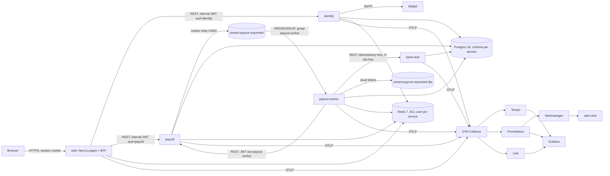

# PayRun architecture (developer view)

This is a short map for developers new to the repo. The authoritative sources are, in order of
precedence: the decision tables (C, then R) in the [spec README](specs/payrun-0.1/README.md),
[`requirements.md`](specs/payrun-0.1/requirements.md), the [ADRs](adr/), the
[high-level design](specs/payrun-0.1/design-high-level.md) and the low-level designs, then the
[architecture plan](plan/architecture-plan.md). Where this page and those disagree, they win.

## Service map



| Component     | Path                     | Responsibility                                                                                  |
| ------------- | ------------------------ | ----------------------------------------------------------------------------------------------- |
| web           | `apps/web`               | Pages, BFF route handlers, sessions, BFF rate limits, internal JWT minting, error mapping       |
| identity      | `services/identity`      | Users, credentials, invites, password resets, roles, auth audit log, email outbox and relay     |
| payroll       | `services/payroll`       | Settings, employees, runs, calculation, approval, payouts and attempts, audit, outbox, re-publish, internal endpoints |
| payout-worker | `services/payout_worker` | Consumes payouts, fetches the instruction, calls the bank, reports results; health endpoints only |
| bank-stub     | `services/bank_stub`     | Simulated processor with a persistent idempotent ledger; dev and uat only, never prod           |
| pycommon      | `libs/pycommon`          | Settings, logging and redaction, OTel, errors, JWT, health, DB, Redis Streams, resilient HTTP client, rate limiter, startup checks, maintenance runner |
| api-client    | `packages/api-client`    | TypeScript types generated from identity and payroll `openapi.json` (the BFF's upstreams)     |

Why these services and not fewer: [ADR 0001](adr/0001-service-map.md) and plan §4. No
synchronous cycles exist: payroll never calls the worker, it only publishes to it.

## Request path

1. The browser talks only to the web app. Pages and `/api/*` route handlers run in Next.js; the
   services are private (no ingress).
2. Each route handler (`apps/web/src/lib/route.ts`) checks the Origin on mutations, applies the
   body limit (64 KB) and the per-session and per-IP rate limits, loads the session from Redis
   (`apps/web/src/lib/require-session.ts`) and checks the route's roles.
3. The BFF mints a fresh **internal JWT** per upstream call (`apps/web/src/lib/internal-jwt.ts`):
   EdDSA (Ed25519), 60 s TTL, claims `iss=web`, `aud=identity|payroll`, `sub` (user ID or
   `service:web` for public flows), `roles`, `cid` (company), `sid`, `name`, `jti`. It sends
   `X-Client-IP` when it knows the client IP.
4. The service verifies the token with pycommon (`libs/pycommon/src/pycommon/auth.py`) against
   its own issuer-bound keyset (`INTERNAL_JWT_PUBLIC_KEYS`, JSON `{kid: {iss, pem}}`): identity
   trusts web keys only; payroll trusts web keys on public routes and the worker key only on
   `/v1/internal/*`. Every query is scoped by the token's `cid`, never by input.
5. Errors come back as `{error: {code, message, request_id, details?}}` and the BFF maps them to
   user-safe messages (`apps/web/src/lib/errors.ts`). See [API.md](API.md).

Budgets: 3 s per upstream attempt (10 s for calculate and approve), GETs retried on
429/502/503/504, a breaker per target (plan §4, spec C62).

## Payout path

The core safety design is [ADR 0003](adr/0003-payout-flow.md): **event out, API back**.

```mermaid
sequenceDiagram
  participant A as Approver (BFF)
  participant P as payroll
  participant S as Redis stream
  participant X as payout-worker
  participant K as bank-stub
  A->>P: POST /v1/pay-runs/{id}/approve (Idempotency-Key)
  P->>P: one tx: run -> processing, payouts + attempt 1, outbox rows
  P->>S: relay XADD stream:payout.requested (IDs and amount only)
  S->>X: XREADGROUP (group payout-worker)
  X->>P: GET /v1/internal/payouts/{id}/instruction (decrypted bank details)
  X->>K: POST /v1/transfers, Idempotency-Key = <payout_id>:<attempt>
  K-->>X: settled | rejected (2xx) or no answer
  X->>P: POST /v1/internal/payouts/{id}/result, Idempotency-Key = <event_id>:<outcome>
  P->>P: apply to the current attempt; run -> paid | partially_failed
```

1. **Approve** (PAY-400) runs in one transaction: the run moves to `processing` (or straight to
   `paid` when every payout is `no_transfer`), payouts and their first attempts are created, and
   one outbox row per payout is written.
2. **Outbox relay** (payroll) publishes `payout.requested.v1` to `stream:payout.requested`
   ([schema](../contracts/events/payout.requested.v1.json)). The event carries IDs and the amount
   only; never names or bank details.
3. **Worker** reads with `XREADGROUP`; crashed consumers' messages are reclaimed by `XAUTOCLAIM`.
   On **every** delivery it fetches the instruction from payroll; a 409 `attempt_not_current`
   means it acknowledges without calling the bank. It uses the instruction's amount, never the
   event's.
4. **Bank call** with `Idempotency-Key = <payout_id>:<attempt>`; the bank-stub's `UNIQUE` key
   returns the original transfer for a repeat, across restarts and replicas.
5. **Result** is posted to payroll, which applies it only to the current attempt.
6. **No answer is never final.** If the bank can't be reached within the delivery budget, the
   worker reports `indeterminate`. payroll's maintenance task **re-publishes** the same attempt
   (same bank key, fresh `event_id`) with backoff from `PAYOUT_REPUBLISH_AFTER_S` (360 s), capped
   at 900 s.
7. **needs_operator.** After `PAYOUT_REPUBLISH_MAX` (10) re-publishes, a poison report
   (schema-invalid, amount mismatch, an expired key window) or a refused envelope, the attempt
   becomes `needs_operator` and `PayoutNeedsOperator` pages. An approver resolves it with
   `redrive` or `mark_rejected` (PAY-502) after checking the bank
   ([runbook](runbooks/PayoutNeedsOperator.md)).
8. **DLQ.** Poison goes to `stream:payout.requested.dlq` at once; payroll-unreachable or worker DB
   failures go there after `PAYOUT_MAX_DELIVERIES` (5) (spec R5,
   [DLQ schema](../contracts/events/payout.requested.dlq.v1.json)).
9. **Retry** (PAY-500): only after a **definite** rejection (2xx `rejected`) does an approver
   retry, which creates attempt n+1 with a new bank key; at most 5 attempts per payout.

State machines for runs and attempts: [HLD §2.1](specs/payrun-0.1/design-high-level.md#21-payout-state-machines).
The full fault table: [HLD §4](specs/payrun-0.1/design-high-level.md#4-failure-handling).

## Data ownership

One Postgres database `payrun` with a schema per service, and one Redis with an ACL user per
service ([ADR 0007](adr/0007-data-stores.md)). Each service connects as `<schema>_app` at runtime
and `<schema>_migrator` for migrations (spec C2); no service can read another's schema.

| Store                                            | Owner (writer)  | Contents                                                                      |
| ------------------------------------------------ | --------------- | ----------------------------------------------------------------------------- |
| schema `identity`                                | identity        | users, credentials, invites, password resets, audit log (append-only), email outbox |
| schema `payroll`                                 | payroll         | company settings, employees (bank fields AES-256-GCM, [ADR 0004](adr/0004-bank-details-at-rest.md)), runs, hours, payslips, payouts, attempts, audit events (append-only), outbox, idempotency keys |
| schema `payouts`                                 | payout-worker   | `disbursements`, `processed_events`                                           |
| schema `bank_stub`                               | bank-stub       | `transfers` with `UNIQUE(idempotency_key)`                                    |
| Redis `web:sess:*`, `web:user-sess:*`, `web:rl:*` | web             | sessions (keyed by an HMAC of the cookie ID) and BFF rate limits              |
| Redis `identity:rl:*`, `payroll:rl:*`            | that service    | rate limits and lockout                                                       |
| `stream:payout.requested`                        | payroll relay   | read by payout-worker; `MAXLEN ~ 100000`                                      |
| `stream:payout.requested.dlq`                    | payout-worker   | read by operators; `MAXLEN ~ 10000`                                           |

Money is integer cents and rates are basis points ([ADR 0006](adr/0006-money-and-rounding.md)).
The worker changes payroll data only through payroll's internal API. The DDL for each schema is
in that service's `migrations/` (Alembic); the roles and grants are in
`deploy/compose/init/*.sql`.

## Identity and sessions

- **Sign-in pattern A, invite-only** ([ADR 0002](adr/0002-sign-in-and-roles.md)). There is no
  self sign-up. The first owner comes from `python -m identity.bootstrap_owner` (a Compose
  one-shot or Kubernetes Job); everyone else is invited by an admin. Invite and reset tokens are
  generated by the email relay at send time and only their hash is stored (spec R17).
- **Passwords:** argon2id, at least 12 characters. Login is limited per account and per IP, with
  lockout backoff; a confirmed reset or an accepted invite clears the lockout (spec C74).
- **Sessions** live in Redis, owned by the BFF: 12 h idle, 7 days absolute, a new ID at sign-in.
  The cookie is `__Host-sid` in uat and prod (`sid` in dev). A reset, role change or
  deactivation revokes them.
- **Role re-check:** the BFF re-reads identity `GET /v1/users/me` when the cached roles are older
  than 60 s (`SESSION_ROLE_RECHECK_S`) and ends the session on a `roles_version` mismatch or
  inactive status. With identity unreachable it keeps cached roles for up to 300 s
  (`SESSION_RECHECK_GRACE_S`), then returns 503 (spec C37).
- **Client IP:** taken from `X-Forwarded-For` with `TRUSTED_PROXY_HOPS` (spec C62); see the
  operator note in [RUNBOOK.md](RUNBOOK.md#client-ip-and-trusted-proxy-hops).
- **Key rotation** for internal JWTs: [web LLD §3.4.1](specs/payrun-0.1/design-low-level-web.md).

## Observability pipeline

Every process (web and the four Python services) exports traces, metrics and logs over OTLP to
the **OTel Collector** (`deploy/observability/collector.yaml`), which sends traces to **Tempo**,
metrics to a Prometheus exporter scraped by **Prometheus**, and logs to **Loki**. **Grafana**
reads all three; **Alertmanager** routes `severity=page` alerts to the page receiver and
`ticket|warning` to the ticket receiver (in dev and CI both are **alert-sink**,
[ADR 0010](adr/0010-alert-receivers.md)).

- Sampling: the apps send 100% (`parentbased_always_on`); prod tail-samples in the Collector
  (`deploy/observability/collector.prod.yaml`; spec R27, C23).
- Logs are one JSON object per line with an `event` name, redacted by pycommon before export.
- Python gauges are computed at metric collection (15 s export interval); the Collector expires
  stale series after 2 minutes (spec C72).
- SLOs ([ADR 0012](adr/0012-slos.md)): BFF availability 99.5%, BFF p95 < 300 ms, settlement
  p95 ≤ 60 s.
- Dashboards (`deploy/observability/grafana/dashboards/`), alert rules
  (`deploy/observability/prometheus/rules/`) and the metric catalogue
  (`deploy/observability/metrics-catalog.json`).

## Key safety rules

- **Payout idempotency ([ADR 0003](adr/0003-payout-flow.md)), guards (a)–(e):** one bank key per
  attempt; the current attempt is checked on every delivery; results apply only to the current
  attempt (a late definite bank answer for a `needs_operator` attempt wins); an uncertain outcome
  is never final and is re-published under the same key; only a definite 2xx `rejected` opens a
  retry. A late `settled` for a rejected or superseded attempt is recorded and pages
  `PayoutLateSettlement` (spec C71).
- **Dual approval ([ADR 0005](adr/0005-four-eyes-approval.md), amended by spec C73):** a company
  setting, on by default and snapshotted onto the run at calculate. With it on, the approver must
  differ from the run's creator, its calculator, the last editor of any hours row on the run, and
  the editor of a not-yet-vetted bank change for any employee who gets a transfer (net > 0); a
  change is vetted once a payout for that employee was released under dual approval by someone
  else. A retry refuses that unvetted bank editor and the operator who marked the current attempt
  rejected. Violations are 403 `approver_must_differ` and audited.
- **Bank details** are encrypted at rest with key IDs; the API shows only the last four digits
  ([ADR 0004](adr/0004-bank-details-at-rest.md)).
- **Secrets:** `.env` in dev and CI, External Secrets in Kubernetes ([ADR 0008](adr/0008-secrets.md)).
- **Browser:** nonce-based CSP ([ADR 0009](adr/0009-csp.md)), Origin checks, SameSite cookies.
- **Egress:** default-deny NetworkPolicies; only payout-worker reaches the bank
  ([ADR 0011](adr/0011-egress.md)).

## Deployment

- **Compose** (`deploy/compose/compose.yaml`): profiles `core` (app, Postgres, Redis, migrations,
  `bootstrap-owner`, Mailpit), `obs` (Collector, Tempo, Loki, Prometheus, Alertmanager,
  alert-sink, Grafana, exporters) and `test` (Toxiproxy, plus `compose.test.yaml`).
- **Kubernetes** (`deploy/k8s`): a Kustomize base with `dev`, `uat` and `prod` overlays.
  bank-stub runs only in dev and uat; prod runs payout-worker with 0 replicas until a
  bank-provider ADR exists (spec R14, C32).
- Details: [HLD §5](specs/payrun-0.1/design-high-level.md#5-deployment) and the
  [platform LLD](specs/payrun-0.1/design-low-level-platform.md).

## Further reading

| Topic                                    | Document                                                                    |
| ---------------------------------------- | --------------------------------------------------------------------------- |
| identity                                 | [design-low-level-identity.md](specs/payrun-0.1/design-low-level-identity.md) |
| payroll and the event contract           | [design-low-level-payroll.md](specs/payrun-0.1/design-low-level-payroll.md) |
| payout-worker                            | [design-low-level-payout-worker.md](specs/payrun-0.1/design-low-level-payout-worker.md) |
| bank-stub                                | [design-low-level-bank-stub.md](specs/payrun-0.1/design-low-level-bank-stub.md) |
| web pages, BFF, e2e and load tests       | [design-low-level-web.md](specs/payrun-0.1/design-low-level-web.md)         |
| pycommon, Compose, observability, k8s, CI | [design-low-level-platform.md](specs/payrun-0.1/design-low-level-platform.md) |
| ADRs 0001–0013                           | [docs/adr/](adr/)                                                           |
