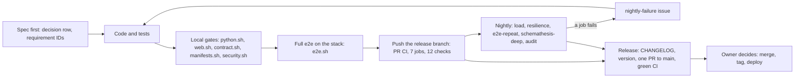

# The engineering workflow, end to end

This page is for developers joining PayRun. It walks a change from the first setup to a release,
and points at the document that holds the details at each step rather than repeating it:

- [README.md](../README.md): prerequisites, quick start, ports, seeded sign-ins, repo layout;
- [CLAUDE.md](../CLAUDE.md): conventions, the command for each gate, toolchain quirks;
- [TESTING.md](TESTING.md): every test layer and gate, and measured results;
- [RUNBOOK.md](RUNBOOK.md): operating the stack, dashboards, alerts, migrations, drills;
- [ARCHITECTURE.md](ARCHITECTURE.md): the services, request and payout paths, deployment;
- the [spec](specs/payrun-0.1/README.md): requirements, designs, tasks and the decision tables.

For what the product does, read [WORKFLOW-PAYROLL.md](WORKFLOW-PAYROLL.md) first.

## Contents

1. [The pipeline at a glance](#the-pipeline-at-a-glance)
2. [First-time setup](#first-time-setup)
3. [Running the stack](#running-the-stack)
4. [Repository layout and ownership](#repository-layout-and-ownership)
5. [How a change flows](#how-a-change-flows)
6. [PR CI](#pr-ci)
7. [The nightly workflow](#the-nightly-workflow)
8. [Alert drills](#alert-drills)
9. [Observability while developing](#observability-while-developing)
10. [Dependency and image security](#dependency-and-image-security)
11. [Releasing](#releasing)
12. [Deployment overview](#deployment-overview)
13. [Alignment reviews](#alignment-reviews)
14. [Where the status lives](#where-the-status-lives)

## The pipeline at a glance



## First-time setup

The tools and their pinned versions (uv, Python 3.14, Node 24 in CI, pnpm 10.34.9 through
corepack, Docker with Compose v2, OpenSSL 3, optional k6) are in the README's
[Prerequisites](../README.md#prerequisites). Then, from the repository root:

```sh
corepack enable
uv sync --all-packages      # the Python workspace: libs/pycommon and services/*
pnpm install                # apps/web and packages/api-client
scripts/dev-env.sh          # writes the git-ignored .env (mode 0600) with fresh secrets
```

`scripts/dev-env.sh` is idempotent: it keeps existing values, adds missing keys and prints only
key names, never values. CI runs it too, so no repository secrets exist. `.env.example` lists every
key with empty secrets. For the Kubernetes dev overlay, `scripts/dev-env.sh --k8s-dev` writes the
git-ignored `deploy/k8s/overlays/dev/secrets.env`.

Two toolchain rules catch newcomers (details in
[CLAUDE.md](../CLAUDE.md#toolchain-pins-and-quirks)):

- **The two-week rule.** `[tool.uv] exclude-newer` in `pyproject.toml` and `minimumReleaseAge`
  in `pnpm-workspace.yaml` only admit releases at least 14 days old.
- **Use `127.0.0.1`, never `localhost`**, for the web origin: the BFF checks the `Origin` of
  every mutation against `PUBLIC_BASE_URL` (spec C12).

## Running the stack

`scripts/stack.sh` wraps Docker Compose (full table in
[RUNBOOK.md](RUNBOOK.md#start-stop-and-reset-the-local-stack)):

| Command                                  | What it does                                                                 |
| ---------------------------------------- | ---------------------------------------------------------------------------- |
| `scripts/stack.sh up`                    | Builds the images, starts profiles `core,obs,test`, waits until healthy      |
| `scripts/stack.sh up --profiles core`    | The app, Postgres, Redis and Mailpit only                                    |
| `scripts/stack.sh up --profiles core,obs` | The app plus the observability stack, at production rate limits            |
| `scripts/stack.sh up --check-startup`    | Also fails if a service took more than 20 s to become ready (PAY-NFR-15)    |
| `scripts/stack.sh seed`                  | The full dev seed (see below)                                                |
| `scripts/stack.sh logs [svc ...]`, `ps`  | Logs with timestamps; container status                                       |
| `scripts/stack.sh psql <role>`           | psql as a database role (e.g. `payroll_app`)                                 |
| `scripts/stack.sh down [-v]`, `reset`    | Stop (`-v` drops the volumes); `reset` is `down -v` then `up`               |

**The profiles.** `core` is the app (web, identity, payroll, payout-worker, bank-stub), Postgres,
Redis, the migration one-shots, `bootstrap-owner` and Mailpit. `obs` adds the Collector, Tempo,
Loki, Prometheus, Alertmanager, alert-sink, Grafana and the exporters. `test` adds Toxiproxy and
the `deploy/compose/compose.test.yaml` override.

**The test profile is on by default.** It routes Postgres and Redis through Toxiproxy, publishes
the service and observability ports, and **raises every rate limit and the login lockout to
1,000,000**, so e2e and load tests don't trip them. To try the production limits (PAY-104,
PAY-603) by hand, start with `--profiles core,obs`.

**Seeding** (dev only: `scripts/seed.py` refuses unless `ENV=dev`) works through the real APIs
and Mailpit, with no back door:

- `scripts/stack.sh seed`: settings (tax 2000 bps, retirement 500 bps, dual approval on), the
  approver and load users, 10 employees on both schedules (one with an account ending `0000`,
  which the bank always rejects), a calculated current-month run and a draft next-month run;
- `--employees 500`: monthly employees up to 500, for k6;
- `--skeleton`: the walking-skeleton set;
- `--out ci-logs/seed.json`: also writes the JSON summary that Playwright, k6 and Schemathesis
  read.

A re-run is a no-op. The sign-ins and where their passwords live are in the README's
[Seeded sign-ins](../README.md#seeded-sign-ins). Schemathesis's stateful phase damages seed data,
so re-seed from a clean stack (`scripts/stack.sh reset`, then `seed`) before anything that reads
it (spec C70).

## Repository layout and ownership

The layout is in the README's [Repository layout](../README.md#repository-layout) and the repo
map in [CLAUDE.md](../CLAUDE.md#repo-map). Ownership rules (CLAUDE.md, tasks.md):

- **Shared files belong to the lead** in multi-agent work: `libs/pycommon`, `contracts/`,
  `scripts/`, `deploy/`, `.github/`, root workspace files and lock files.
- **Contracts are the lead's too.** `services/*/openapi.json` (generated) and
  `contracts/events/*.json` change only together with their producer and consumer tests; a
  subagent that needs a contract change stops and reports it.
- **Generated files are never edited by hand:** `packages/api-client/src/generated/`, the
  `openapi.json` files, and the Kubernetes copies of shared assets.

## How a change flows

### 1. Spec first

Decide before you code. The authority, highest first, is (spec README, CLAUDE.md):

> the **Contract decisions** table (C) > the **Spec resolutions** table (R) >
> [`requirements.md`](specs/payrun-0.1/requirements.md) > the [ADRs](adr/) > the designs
> (`design-high-level.md`, `design-low-level-*.md`) > the [plan](plan/architecture-plan.md)

Both tables are in the [spec README](specs/payrun-0.1/README.md). A new decision gets the next C
number there, and every lower document that it touches is updated to match in the same change.
New work also lands in [`tasks.md`](specs/payrun-0.1/tasks.md).

**Tests cite requirement IDs** (`PAY-…`, `PAY-NFR-…`) in a docstring or comment, so traceability
can be checked. A flake is a bug: no test retries.

### 2. Code

Follow the conventions in [CLAUDE.md](../CLAUDE.md#conventions): structured `log_event` names,
metric and span naming, the error format, integer cents and basis points, every query scoped by
the token's `cid`, and no test literals that look like credentials. Unit tests have no network;
integration tests reach only Testcontainers.

### 3. Local gates

Each CI job runs one script, and each script runs the same way on your machine (Docker needed for
Testcontainers and the pinned tool images). Details per gate: [TESTING.md](TESTING.md).

| Gate                                         | Command                                         | Details |
| -------------------------------------------- | ----------------------------------------------- | ------- |
| Python member: ruff, format, `mypy --strict`, unit, contract and integration tests, coverage (90% pycommon, 85% services) | `scripts/ci/python.sh <pycommon\|identity\|payroll\|payout_worker\|bank_stub\|platform>` | [TESTING](TESTING.md#python-lint-types-unit-contract-integration) |
| Web: ESLint, Prettier over the repo, `tsc`, Vitest (80% lines), real-Redis int tests, build without secrets | `scripts/ci/web.sh` | [TESTING](TESTING.md#web-lint-types-vitest-int-build) |
| Contract: OpenAPI and client drift, oasdiff breaking changes against `origin/main`, event schemas and examples | `scripts/ci/contract.sh [base-ref]` | [TESTING](TESTING.md#contract-drift-breaking-changes-event-schemas) |
| Manifests: k8s copies in sync, kustomize + kubeconform for every overlay, k8s policy test, promtool, amtool, Collector config, `docker compose config` | `scripts/ci/manifests.sh` | [TESTING](TESTING.md#deploy-assets-and-security) |
| Images: `.trivyignore` policy, bake for linux/amd64, Trivy HIGH/CRITICAL | `scripts/ci/images.sh` | [TESTING](TESTING.md#deploy-assets-and-security) |
| Security: pip-audit, pnpm audit, gitleaks | `scripts/ci/security.sh` | [TESTING](TESTING.md#deploy-assets-and-security) |

Run the gates your change touches. Schemathesis isn't part of `contract.sh`: it runs against the
live stack inside `e2e.sh` (`scripts/ci/schemathesis.sh`, 50 examples per operation) and nightly
with 500.

**Scan for secrets before every commit.** The repository is public. Run gitleaks through
`scripts/ci/security.sh` (`GITLEAKS_BASE=<sha>` limits it to your new commits), plus the optional
local scanner where installed ([CLAUDE.md](../CLAUDE.md#conventions)).

### 4. The full e2e

```sh
scripts/ci/e2e.sh                        # E2E_SUITE=full, the default and the CI setting
E2E_SUITE=skeleton scripts/ci/e2e.sh     # the walking skeleton only
E2E_KEEP_STACK=1 scripts/ci/e2e.sh       # leave the stack up for debugging
```

It builds the images, starts the stack with `--check-startup`, seeds, then runs Playwright
(`@journeys` J1–J5, role changes and errors, `@trace`, `@a11y`), the seed tests, k6 smoke,
Schemathesis, the fault smoke tests and `scripts/ci/check_metrics.sh`, in that order, and always
tears the stack down. A skipped seed or fault test fails the job. Order, commands and by-hand
variants: [TESTING.md](TESTING.md#end-to-end-on-the-stack).

### 5. Resilience tests

`tests/resilience/` injects faults into the running stack through Toxiproxy and container stops:
worker crash, bank down, bank timeout after settling, bank restart, payroll down, Redis down,
`FLUSHALL` and restart, Postgres down, slow DB, identity down and SMTP down.

```sh
uv run pytest tests/resilience -m smoke     # the 2 PR tests, on a running stack
scripts/ci/nightly-resilience.sh            # all 13 on a fresh stack (about 30 to 35 minutes)
```

Payout timing stays at production values (spec C53), so several tests wait out a re-publish.
See [TESTING.md](TESTING.md#resilience-fault-injection).

### 6. Regenerating OpenAPI and the API client

After any API change:

```sh
uv run python scripts/export_openapi.py --all && pnpm --filter @payrun/api-client generate
```

Commit the regenerated `services/*/openapi.json` and `packages/api-client/src/generated/`;
`contract.sh` fails on any drift (`export_openapi.py --check` only reports). A new error code also
goes into the service's OpenAPI responses and the BFF catalogue `apps/web/src/lib/errors.ts`.
oasdiff fails a breaking change against the base branch.

### 7. Migrations

Each service owns one Postgres schema with Alembic migrations in
`services/<svc>/migrations/versions/`, numbered in order (for example
`services/payroll/migrations/versions/0003_c73_four_eyes.py`). Migrations are **expand-only**, so
the previous release keeps working and a rollback is the previous image tags. The runtime role
never gets rights in another schema, and the audit tables stay append-only (PAY-606).

- The integration tests migrate a Testcontainers database to head, so `python.sh` exercises a new
  migration.
- `scripts/stack.sh up` runs the `migrate-<schema>` one-shots before the services start; each
  service's `/readyz` fails until its schema is at head.
- In Kubernetes they run as versioned Jobs. Order and commands:
  [RUNBOOK.md](RUNBOOK.md#migrations).

### 8. Keeping the Kubernetes copies in sync

Kustomize can't load files outside its tree, so a few shared assets are committed as copies (the
bootstrap SQL, the Redis config, the Collector configs). Edit only the sources, then:

```sh
scripts/sync-k8s-assets.sh            # copy the sources into deploy/k8s
scripts/sync-k8s-assets.sh --check    # report stale copies, change nothing
```

`manifests.sh` runs the sync and fails on any diff, so a stale copy fails CI (spec R32, C36).

## PR CI

`.github/workflows/ci.yml` runs on every pull request and on pushes to `main`. It has 7 jobs; the
`python` matrix has 6 members, so a PR shows 12 checks, and all of them must be green. There are no repository
secrets: jobs that need keys run `scripts/dev-env.sh`. Actions are pinned to full commit SHAs.

| Job                 | Script                          | Timeout | What it proves                                                                 |
| ------------------- | ------------------------------- | ------- | ------------------------------------------------------------------------------ |
| `python` (6 members) | `scripts/ci/python.sh <member>` | 20 min  | Lint, strict types, unit, contract and integration tests on real Postgres and Redis, coverage gates |
| `web`               | `scripts/ci/web.sh`             | 15 min  | Lint, formatting, types, Vitest coverage, sessions and rate limits on real Redis, a build that needs no secrets |
| `contract`          | `scripts/ci/contract.sh`        | 15 min  | Committed OpenAPI and client match the code; no breaking API change against the base; events match their schemas |
| `e2e`               | `scripts/ci/e2e.sh` (full)      | 40 min  | The stack starts within budget; J1–J5 in a browser; one trace across J4; accessibility; seed; k6 smoke; Schemathesis; fault smoke; required metrics present |
| `images`            | `scripts/ci/images.sh`          | 30 min  | Images build for linux/amd64 with no unaccepted HIGH or CRITICAL CVE           |
| `manifests`         | `scripts/ci/manifests.sh`       | 10 min  | Kubernetes overlays are valid and follow policy; alert rules and their tests pass; Alertmanager, Collector and Compose configs are valid |
| `security`          | `scripts/ci/security.sh`        | 10 min  | No unaccepted Python or JS advisory; no secret in the new commits              |

On failure, `e2e` uploads `ci-logs/` and `load/results/` as an artifact.

## The nightly workflow

`.github/workflows/nightly.yml` runs at 03:17 UTC every day (on the default branch) and on
`workflow_dispatch`, which can target another branch such as the release branch. Each job tees
its script's output to `ci-logs/<job>.log` and uploads it.

| Job                 | Script                               | Timeout | First full pass (run 43074520518) | What it covers |
| ------------------- | ------------------------------------ | ------- | --------------------------------- | -------------- |
| `load`              | `scripts/ci/nightly-load.sh`         | 100 min | 47 min                            | k6 `full` (30 ops/s for 10 min), `soak` (30 min, with drift, memory and lag checks) and `settlement` (500-employee runs, p95 ≤ 60 s) |
| `resilience`        | `scripts/ci/nightly-resilience.sh`   | 60 min  | 35 min                            | All 13 fault-injection tests                                        |
| `e2e-repeat`        | `scripts/ci/nightly-e2e.sh`          | 120 min | 28 min                            | The full e2e three times on fresh stacks, to catch flakes           |
| `schemathesis-deep` | `scripts/ci/nightly-schemathesis.sh` | 45 min  | passed                            | Schemathesis with 500 examples per operation                        |
| `audit`             | `scripts/ci/nightly-audit.sh`        | 20 min  | passed                            | pip-audit and pnpm audit against fresh advisories; images rebuilt and scanned with a fresh Trivy DB |

**Failures open issues.** When any job fails, the `report` job (the only one with
`issues: write`) runs `scripts/ci/report_failure.sh` for each failed job. It opens, or comments on,
an issue titled "Nightly failure: *job*" with the label `nightly-failure`, the run URL, the commit
and the last 150 lines of the log with secrets scrubbed. A green night never closes the issue: a
person closes it once the cause is fixed. Results and history:
[TESTING.md](TESTING.md#measured-results-2026-11-11).

## Alert drills

`scripts/ci/alert_drills.sh` proves on the live stack that each of the six paging alerts fires,
reaches alert-sink `/page` with its runbook link, shows its cause on the dashboard, and clears. It
stops containers and changes Toxiproxy, so it runs by hand, never in CI:

```sh
scripts/stack.sh up && scripts/stack.sh seed
scripts/ci/alert_drills.sh                                  # all six, one after another
scripts/ci/alert_drills.sh PayoutDLQ PayoutNeedsOperator    # a subset
```

The PayoutsStuck drill takes about 22 minutes by design. Re-run the affected drills after
changing a paging rule, a metric behind one, or the alert routing. What each drill does and its tuning variables:
[RUNBOOK.md](RUNBOOK.md#alert-drills).

## Observability while developing

With the `obs` profile up (the default), every process exports traces, metrics and logs over
OTLP to the Collector ([ARCHITECTURE.md](ARCHITECTURE.md#observability-pipeline)).

- **Grafana** at <http://127.0.0.1:4101> (user `admin`, password `GRAFANA_ADMIN_PASSWORD` in
  `.env`) has five dashboards: Service overview, Journeys, Queues and workers, Bank (stub)
  dependency and Platform ([RUNBOOK.md](RUNBOOK.md#dashboards)). Their source is
  `deploy/observability/grafana/dashboards/`.
- **Traces** (Tempo) and **logs** (Loki) are browsed through Grafana Explore. Every BFF response
  carries `x-request-id` and `x-trace-id`, so you can jump from a browser request to its trace;
  one J4 approval is a single trace across web, payroll, the stream, payout-worker and the bank
  (PAY-NFR-09). Logs are JSON with an `event` field, for example
  `{service_name="payroll"} | event="payout.needs_operator"`.
- **Prometheus** at <http://127.0.0.1:4132> and **Alertmanager** at <http://127.0.0.1:4133> (test
  profile). alert-sink (<http://127.0.0.1:4135/page>, `/ticket`) shows what was delivered.
- **Adding a metric:** follow the naming rules in [CLAUDE.md](../CLAUDE.md#conventions), add it
  to `deploy/observability/metrics-catalog.json` (the dashboards are checked against it), and to
  `scripts/ci/check_metrics.sh` if e2e must see it.

## Dependency and image security

| Tool       | Where it runs                                          | Fails on                                         |
| ---------- | ------------------------------------------------------ | ------------------------------------------------ |
| Trivy      | `scripts/ci/images.sh` (PR `images`, nightly `audit`)  | any HIGH or CRITICAL image CVE not accepted      |
| pip-audit  | `scripts/ci/security.sh` (PR `security`, nightly `audit`) | any Python advisory not accepted (`--strict`) |
| pnpm audit | `scripts/ci/security.sh`                               | any JS advisory at `high` or above not accepted  |
| gitleaks   | `scripts/ci/security.sh`                               | any secret in `<base>..HEAD`                     |

**Accepted findings** are the exception, allowed only when no fix exists yet. Each is recorded in
[`SECURITY_DEPENDENCIES.md`](../SECURITY_DEPENDENCIES.md), with a reason, an owner and an expiry
date. For Trivy it also goes into `.trivyignore`, whose policy step checks every field, the expiry
and the listing; `security.sh` reads the pip-audit IDs straight from that file and fails on an
expired row; a pnpm acceptance would go into `pnpm.auditConfig.ignoreGhsas` in the root
`package.json` (none exists today). Once an expiry passes, the gate fails again, and the finding
must be fixed (upgrade, rebuild on a patched base) or re-reviewed and renewed. The nightly
`audit` job uses fresh advisory databases, so a new CVE or an acceptance that expired overnight
fails there first. Dependabot proposes updates with a 14-day cooldown, matching the two-week
rule.

## Releasing

0.1.0 is the first release; the same flow applies to the next one.

1. **Work on a release branch** (`release/0.1.0`). After the walking skeleton on `main`, the
   feature, hardening and release tasks of 0.1.0 were all committed there.
2. **Update [CHANGELOG.md](../CHANGELOG.md)** in the [Keep a Changelog](https://keepachangelog.com/en/1.1.0/)
   format: move `[Unreleased]` entries into a `## [x.y.z] - date` section (Added, Fixed,
   Security, …) and update the compare links at the bottom. The project uses Semantic Versioning.
3. **Set the version** everywhere it lives: `version` in the root and member `pyproject.toml`
   files and in `apps/web/package.json` and `packages/api-client/package.json`; the image tags in
   the uat and prod overlays and the version labels under `deploy/k8s/`; and the migration Jobs'
   `nameSuffix` in `deploy/k8s/base/migrations/kustomization.yaml` (a Job's pod template is
   immutable, so each release needs new Job names; `test_k8s_policy.py` keeps the bank-stub Job
   in step). `git grep` the old version to find the rest.
4. **Update the docs and status lines** ([Where the status lives](#where-the-status-lives)), and
   re-run the full local e2e.
5. **Open one PR** from the release branch to `main` and fix CI until all 12 checks are green.
   For 0.1.0 that is PR #11.
6. **Merge, tag and deploy are the owner's decisions.** A contributor or agent stops at a green
   PR. The CHANGELOG links expect a `v0.1.0` tag.

## Deployment overview

| Environment | How                                                                                                         |
| ----------- | ----------------------------------------------------------------------------------------------------------- |
| dev (local) and CI | Docker Compose (`deploy/compose/`), secrets in the generated `.env`                                  |
| dev (cluster) | Kustomize overlay `deploy/k8s/overlays/dev`: bank-stub, in-cluster Postgres and Redis, Mailpit; secrets from `secrets.env` |
| uat         | Overlay `uat`: bank-stub and Mailpit, managed Postgres and Redis, ingress, secrets from **ExternalSecret** resources |
| prod        | Overlay `prod`: managed data stores, ingress, SMTP and bank egress, **ExternalSecret** resources; no bank-stub, and payout-worker at 0 replicas until a bank-provider ADR exists (spec R14, C32) |

The base adds Deployments, PDBs, default-deny NetworkPolicies
([ADR 0011](adr/0011-egress.md)), a `db-bootstrap` Job, versioned migration Jobs and a
`bootstrap-owner` Job. The uat and prod overlays read secrets through a `ClusterSecretStore`
named `payrun-secrets` ([ADR 0008](adr/0008-secrets.md)); every `REPLACE` in them (registry,
hosts, CIDRs) is for the environment's owner to fill in. Deploy order: `db-bootstrap` →
`migrate-*` → services → web → `bootstrap-owner` (first time only)
([RUNBOOK.md](RUNBOOK.md#migrations)). More: [ARCHITECTURE.md](ARCHITECTURE.md#deployment),
[HLD §5](specs/payrun-0.1/design-high-level.md#5-deployment) and the
[platform LLD](specs/payrun-0.1/design-low-level-platform.md).

## Alignment reviews

Code, specs and plan drift apart as work lands, so they are checked against each other at set
points: after the specs, after the walking skeleton, before the release review, after the
security review, and after the first full nightly pass. Each review:

1. runs independent reviewers over the code, tests and documents;
2. verifies every finding against the repository, and fixes each one that holds, or records why
   not (an accepted risk or a documented limit);
3. records each new decision as the next C row in the [spec README](specs/payrun-0.1/README.md)
   and updates the lower documents (requirements, ADRs, designs, plan) to match, so no document
   contradicts a decision above it;
4. adds a dated row to the plan's §18 ledger
   ([Checks (dated)](plan/architecture-plan.md#18-checks-dated)): the pass, the findings that
   held, and the fix.

Measurements and deviations found while building (for example drill timings or a tool pin) are
recorded as C rows too.

## Where the status lives

See [CLAUDE.md](../CLAUDE.md#where-the-status-lives):

- task status: the Status column of [`tasks.md`](specs/payrun-0.1/tasks.md), with a status line
  at the top;
- decisions and measurements: the C and R tables in the [spec README](specs/payrun-0.1/README.md),
  whose status line also records the release state;
- the plan's status line and its dated checks in [§18](plan/architecture-plan.md#18-checks-dated);
- release notes: [CHANGELOG.md](../CHANGELOG.md);
- open nightly failures: GitHub issues labelled `nightly-failure`.
