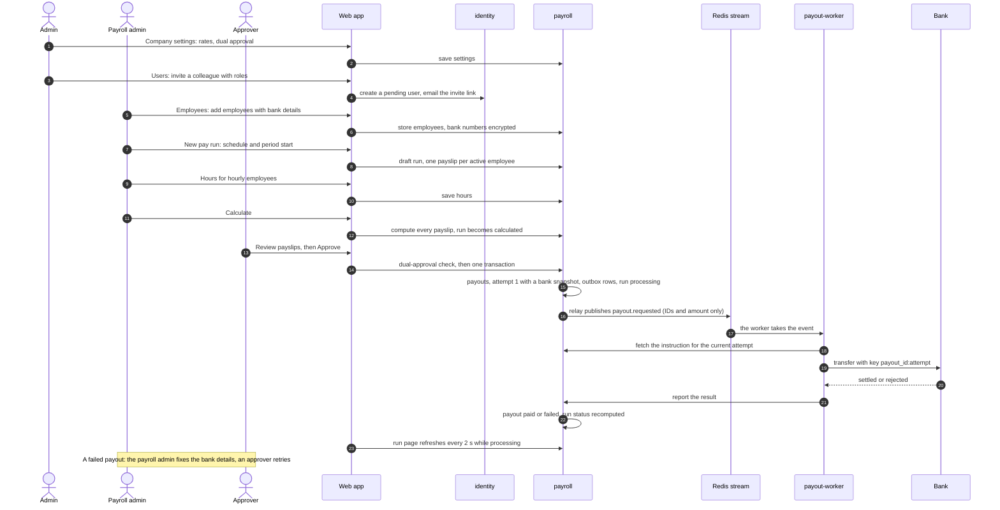
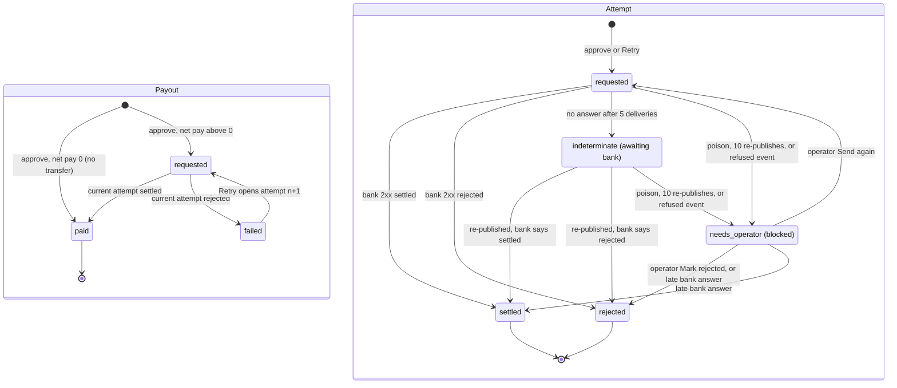

# The payroll workflow, end to end

This page follows one pay period through PayRun, from company setup to the last payout. It is
written for product owners, operators and new team members. For each step it says **who** does
it, **what they see** in the web app, and **what the system does** behind the screen.

Rules are cited by ID: requirements `PAY-…` are in
[`requirements.md`](specs/payrun-0.1/requirements.md), ADRs in [`docs/adr/`](adr/), and the
decision rows (`R…`, `C…`) in the [spec README](specs/payrun-0.1/README.md). The developer view
of the same flow is [ARCHITECTURE.md](ARCHITECTURE.md); the on-call view is
[RUNBOOK.md](RUNBOOK.md).

## Contents

1. [Who does what](#who-does-what)
2. [The period at a glance](#the-period-at-a-glance)
3. [Company setup](#1-company-setup)
4. [Staff access](#2-staff-access)
5. [Employees and bank details](#3-employees-and-bank-details)
6. [Create a run](#4-create-a-run)
7. [Enter hours](#5-enter-hours)
8. [Calculate](#6-calculate)
9. [Review](#7-review)
10. [Approve](#8-approve)
11. [Paying the employees](#9-paying-the-employees)
12. [Statuses](#statuses)
13. [A payment fails: fix and retry](#a-payment-fails-fix-and-retry)
14. [Awaiting bank: no answer yet](#awaiting-bank-no-answer-yet)
15. [Blocked: an operator decides](#blocked-an-operator-decides)
16. [Late settlement: a possible double payment](#late-settlement-a-possible-double-payment)
17. [The audit trail](#the-audit-trail)
18. [The guarantees](#the-guarantees)

## Who does what

PayRun has three roles. A user may hold several; the first user (the owner) holds all three
([ADR 0002](adr/0002-sign-in-and-roles.md)). Employees are paid by PayRun but never sign in.

| Role            | Does                                                                                      |
| --------------- | ----------------------------------------------------------------------------------------- |
| `admin`         | Invites users and changes their roles, edits company settings, reads both audit logs     |
| `payroll_admin` | Adds and edits employees and their bank details; creates runs, enters hours, calculates and deletes runs |
| `approver`      | Approves runs, retries failed payouts, resolves blocked payouts                           |

Every role can view runs, payslips and employees, salaries included (ADR 0002). The full matrix
is plan §8 ([architecture plan](plan/architecture-plan.md#8-identity-and-security)). The web app
shows only the navigation and buttons a user's roles allow (**Users** and **Audit** appear for
admins only), and every service checks the role again on each request (PAY-601).

The system has five parts that matter here:

| Part          | What it does in this workflow                                                                 |
| ------------- | --------------------------------------------------------------------------------------------- |
| web app       | The pages, plus the server side (BFF) that holds sessions and calls the services              |
| identity      | Users, roles, passwords, invites and resets, the sign-in audit log                            |
| payroll       | Settings, employees, runs, pay calculation, approval, payouts and their audit log             |
| payout-worker | Takes each payout from a queue, asks the bank to pay it, and reports the answer to payroll    |
| bank-stub     | A simulated bank with a persistent ledger (dev and uat only; production needs a real provider) |

## The period at a glance

## 1. Company setup

**Who:** an `admin`. **Where:** **Settings** (`/settings`, page "Company settings"). Other roles
see the page read-only.

| Field                     | Meaning                                                                                  |
| ------------------------- | ---------------------------------------------------------------------------------------- |
| Company name              | 1 to 200 characters                                                                      |
| Tax rate (%)              | Stored as basis points, 0 to 5000 (0% to 50%)                                            |
| Retirement rate (%)       | Stored as basis points, 0 to 2000 (0% to 20%)                                            |
| Time zone                 | IANA name, default `America/New_York`                                                    |
| Biweekly anchor           | A Monday (default 2026-01-05); biweekly periods start every 14 days from it              |
| Require dual approval     | On by default; turning it off asks "Turn off dual approval?" first                       |

**Behind it:** payroll validates and saves the settings and writes a `settings.updated` audit
event with the changed fields (PAY-200). The biweekly anchor can't change once any biweekly run
exists (409 `anchor_locked`, R33). Turning dual approval off doesn't touch runs that are already
calculated: each run keeps the value it had when it was calculated (ADR 0005).

## 2. Staff access

### Inviting staff

**Who:** an `admin`. **Where:** **Users** (`/users`): **Invite user** (email, name, roles),
**Edit roles**, **Deactivate**, and **Resend invite** for a pending user.

**Behind it:** identity creates a `pending` user and queues an email. The email relay sends a
one-time link that is valid for 72 hours from sending; only a hash of the token is stored
(PAY-101, R17). **Resend invite** replaces the link (PAY-102). An admin can't change their own
roles or status (409 `cannot_modify_self`), and the last active admin can't be removed
(`last_admin`, PAY-108). A role change or deactivation takes effect within 60 seconds: the web
app re-checks the user's roles at least once a minute and ends the session if they changed
(PAY-107).

### Accepting and signing in

**Who:** the invitee. **Where:** the emailed link opens **Accept your invite** (`/accept`), where
they choose a password of at least 12 characters. Then **Sign in to PayRun** (`/login`).

**Behind it:** identity activates the user and stores an argon2id password hash; the web app
creates a session in Redis (12 hours idle, 7 days at most) (PAY-103, PAY-106). The token is in
the link's fragment, so it never reaches a server log.

### Password reset

**Where:** **Forgot password?** on the sign-in page opens **Reset your password** (`/reset`).

**Behind it:** the request always gets the same answer, whether or not the email is known, and
is padded so that both take about the same time (PAY-105, C74). A known, active user gets a link valid for 1 hour. Setting the
new password ends every existing session of that user, and the sign-in page shows "Password
changed. Sign in with your new password."

### Lockout

Sign-in allows 5 failed attempts per account and 20 attempts per IP address in 15 minutes. Past
that, the user sees "Too many requests. Try again in N seconds." and the account locks for 1
minute, doubling up to 60 minutes (PAY-104). An unknown email locks the same way, so the
response never reveals which emails exist (R15). A confirmed password reset or an accepted invite
clears the lockout (C74).

> The default local stack is a test stack that raises these limits to 1,000,000; see the note in
> the [README](../README.md#quick-start).

## 3. Employees and bank details

**Who:** a `payroll_admin` edits; every role can view. **Where:** **Employees** (`/employees`),
**Add employee** (`/employees/new`), and each employee's page (`/employees/{id}`) with **Change
bank details**, **Deactivate** or **Reactivate**, and **Edit details**.

An employee has a name, an email, a pay type (salaried with an annual salary, or hourly with a
rate), a schedule (monthly or biweekly) and bank details: a 9-digit routing number (checked with
the ABA checksum) and a 4 to 17 digit account number (PAY-201).

**What they see:** bank accounts appear only as `••••1234`, the last four digits, everywhere in
the app and the API. The employee page shows when the bank details last changed and by whom.

**Behind it:** payroll encrypts both bank numbers with AES-256-GCM before storing them and keeps
only the last four digits in clear for display ([ADR 0004](adr/0004-bank-details-at-rest.md),
PAY-204). No user-facing API ever returns the full numbers (PAY-202). Every bank change records who
made it and when, which dual approval uses later; creating an employee counts as a bank change
(R34). A deactivated employee's bank details are erased 30 days after deactivation, once none of
their payouts is still in progress (PAY-608); reactivating them then asks for new bank details.

## 4. Create a run

**Who:** a `payroll_admin`. **Where:** **New pay run** (`/pay-runs/new`, also on the
**Dashboard**): choose **Schedule** (Monthly or Biweekly) and **Period start**; the form suggests
valid starts.

| Schedule | Period start                     | Period end         | Periods a year |
| -------- | -------------------------------- | ------------------ | -------------- |
| Monthly  | the 1st of a month               | the month's last day | 12           |
| Biweekly | the anchor plus a multiple of 14 days | start + 13 days | 26           |

The pay date is the period's last day (PAY-300).

**Behind it:** payroll creates a `draft` run with one `pending` payslip for each active employee
on that schedule. Each payslip copies the employee's name, pay type and salary or rate at that
moment, so later edits to the employee don't change this run. Payroll refuses:

- a second run for the same schedule and period (409 `pay_run_exists`, unless the earlier one was
  deleted);
- an invalid start (422 `invalid_period_start`);
- a schedule with no active employees (409 `no_employees`);
- an employee whose days are already in another run (409 `employee_in_overlapping_run`).

A `draft` or `calculated` run can be deleted with **Delete run**, which frees the period
(PAY-304).

## 5. Enter hours

**Who:** a `payroll_admin`. **Where:** the run page (`/pay-runs/{id}`, "Pay run *start* –
*end*"), section **Hours**, which lists the hourly employees.

**Behind it:** payroll stores hours in hundredths (0 to 336.00 for a biweekly period, 0 to 744.00
for a monthly one) and records who entered each row (PAY-301). Hours can change while the run is
`draft` or `calculated`. Saving hours on a `calculated` run moves it back to `draft` (the page
says so), so it must be calculated again before approval.

## 6. Calculate

**Who:** a `payroll_admin`. **Where:** **Calculate** on the run page.

**Behind it:** payroll computes every payslip with whole numbers only
([ADR 0006](adr/0006-money-and-rounding.md), PAY-302). Money is integer cents and rates are basis
points (1 bp = 0.01%), so there is never a floating-point rounding error.

| Line        | Rule                                                                                            |
| ----------- | ----------------------------------------------------------------------------------------------- |
| Gross (salaried) | annual salary ÷ periods (12 or 26); the leftover cents go to the last periods of the year, so the year adds up exactly |
| Gross (hourly)   | rate × hours, rounded half up to the cent                                                  |
| Tax         | gross × tax rate, rounded half up                                                               |
| Retirement  | gross × retirement rate, rounded half up                                                        |
| Net         | gross − tax − retirement (never negative, because of the rate limits above)                     |

Calculate also copies the current tax rate, retirement rate and dual-approval setting onto the
run, records the user as `calculated_by`, and moves the run to `calculated`. It refuses a run with
an hourly payslip that has no hours (422 `hours_missing`; the page highlights those rows).

**A payslip contains:** the employee, the pay type, the annual salary or the hourly rate and
hours, and gross, tax, retirement and net. For every payslip gross = net + tax + retirement, and
the run's funding total is the sum of the nets (PAY-303, PAY-NFR-01).

## 7. Review

**Who:** anyone; in practice the payroll admin and the approver. **Where:** the run page shows
the schedule, pay date, employee count, rates, totals (gross, tax, retirement, net, **Funding
required**), who calculated it, and a **Dual approval** tag when it applies. The **Payslips** tab
lists each employee's lines with run totals; clicking a name opens the payslip.

**Behind it:** the totals are sums of the stored payslips, never recalculated from rates
(ADR 0006). Nothing changes until someone approves.

## 8. Approve

**Who:** an `approver`. **Where:** **Approve** on a `calculated` run, then **Confirm approval**
("Approve paying *n* employee(s), funding *$x*?").

### Who may approve under dual approval

When the run's dual-approval copy is on, the approver must not be any of these
([ADR 0005](adr/0005-four-eyes-approval.md) as amended by C73; PAY-401):

1. the person who **calculated** the run;
2. the person who **created** the run;
3. the **last editor of any hours row** on the run;
4. the person who made a **not-yet-vetted bank change** for any employee who gets a transfer in
   this run (net pay above 0).

A bank change is *vetted* once a payout for that employee, in a run with dual approval on, took a
snapshot of the new details and was released by someone other than the editor. Until then, the
editor can't release money to those details. Employees with net pay 0 get no transfer, so their
bank changes don't count either way.

If the rule blocks the user, they see "Dual approval is on: someone else must approve. You
created, calculated or entered hours for this run, or changed bank details that a second person
hasn't released yet." (403 `approver_must_differ`), and payroll writes a `payrun.approve_denied`
audit event. The page warns in advance when the user created or calculated the run; the hours
and bank rules are checked only by payroll.

With dual approval off, any approver may approve, including the person who prepared the run.
Known gap (accepted for 0.1.0, C73): a change to an employee's salary or hourly rate is audited
but not covered by dual approval.

**Behind it:** payroll approves in a single transaction (PAY-400). The browser sends a fresh
idempotency key with each click, so a double click or a network retry approves only once; a
second approval gets 409 `pay_run_not_approvable`. Approval fails with 409
`employee_bank_details_missing` if an employee who needs a transfer has no bank details.

## 9. Paying the employees

**Who:** nobody; this runs in the background. **Where:** the run page shows "Paying employees:
*x* of *y* paid", with counts of payouts awaiting the bank and blocked; the run page and its open
**Payouts** tab refresh every 2 seconds until the run is final (PAY-413). The **Dashboard** lists
runs in progress under "Paying now", with their blocked count.

The design is "event out, API back" ([ADR 0003](adr/0003-payout-flow.md)):

1. **Payouts and the bank snapshot.** In the approval transaction, payroll creates one payout per
   payslip. A payout with net pay above 0 gets attempt 1, with an encrypted copy (snapshot) of the
   employee's bank details as they are at that moment; later edits to the employee don't change
   it. A payout with net pay 0 is `paid` at once with no transfer. The run becomes `processing`,
   or `paid` if no transfer is needed at all.
2. **Outbox and stream.** In the same transaction payroll writes one `payout.requested` event per
   transfer into its outbox table, so the event exists if and only if the approval committed
   (PAY-402). A relay then publishes it to the Redis stream `stream:payout.requested`. The event
   carries only IDs and the amount: never names or bank details.
3. **The worker.** payout-worker reads the stream (up to 16 payouts at once, PAY-403). For every
   delivery it asks payroll for the payment instruction. Payroll answers only for the payout's
   current attempt, and only while it is `requested` or `indeterminate`; otherwise the worker drops the message without
   calling the bank. The worker takes the amount and bank details from the instruction, never
   from the event.
4. **The bank.** The worker sends the transfer with the idempotency key `<payout_id>:<attempt>`.
   The bank stores that key; a repeat of the same key returns the original transfer instead of
   paying again, even across restarts (PAY-412). Only HTTP 2xx `settled` or 2xx `rejected` with a
   reason count as an answer; anything else (timeouts, errors, 4xx) is "no answer" (PAY-404).
5. **The result.** The worker reports the answer to payroll with the key `<event_id>:<outcome>`.
   Payroll applies it only to the current attempt: `settled` makes the payout `paid`, `rejected`
   makes it `failed` (PAY-405). It then recomputes the run status.

The settlement target is that a 500-employee run is fully paid within 60 seconds of approval at
the 95th percentile ([ADR 0012](adr/0012-slos.md), PAY-NFR-06).

## Statuses

### Payouts and attempts

A payout is one employee's payment in a run. Each try to pay it is an attempt, with its own bank
key. A payout has at most 5 attempts (PAY-500).

The same machines, with the run's, are in
[HLD §2.1](specs/payrun-0.1/design-high-level.md#21-payout-state-machines). How each status shows
in the app:

| Attempt status   | Payout status | Payouts tab badge          | History label | Final? |
| ---------------- | ------------- | -------------------------- | ------------- | ------ |
| `requested`      | `requested`   | Processing                 | Requested     | no     |
| `indeterminate`  | `requested`   | Awaiting bank              | Awaiting bank | no     |
| `needs_operator` | `requested`   | Blocked                    | Blocked       | no     |
| `settled`        | `paid`        | Paid                       | Settled       | yes    |
| `rejected`       | `failed`      | Failed, with the reason    | Rejected      | yes    |
| (no attempt)     | `paid`        | Paid (no transfer)         | "No transfer was needed." | yes |

Rejection reasons shown: "Account closed", "Insufficient funds at the bank", "Rejected by an
operator" and "Bank key expired".

### The run

A run goes `draft` ⇄ `calculated` (calculate; saving hours goes back) → approve → `processing`
(or straight to `paid` when nothing needs a transfer). After approval its status is never set by
hand; it is a pure function of its payouts (PAY-406):

| If                                   | Run status         |
| ------------------------------------ | ------------------ |
| any payout is `requested`            | `processing`       |
| otherwise, every payout is `paid`    | `paid`             |
| otherwise (some `failed`)            | `partially_failed` |

So a run with a blocked or awaiting-bank payout stays `processing`, and a retry moves a
`partially_failed` run back to `processing`. `paid` and `partially_failed` are the final run
statuses; the **Dashboard** lists `partially_failed` runs under "Needs attention".

## A payment fails: fix and retry

This is journey J5. In the dev seed, employee 9's account ends `0000`, which the bank-stub always
rejects as "Account closed".

1. **See it.** The bank's definite rejection makes the payout `failed`; once nothing else is in
   progress, the run is `partially_failed`. Anyone sees the payout as **Failed** with the reason
   on the **Payouts** tab (filter **Failed**), and **History** lists every attempt with its
   account `••••last4` and times (PAY-501).
2. **Fix the bank details.** A `payroll_admin` opens the employee and uses **Change bank
   details**. The failed attempt keeps its old snapshot; the change applies to the next attempt.
3. **Retry.** An `approver` clicks **Retry** on the failed payout (PAY-500). Payroll creates
   attempt *n* + 1 with a new bank key and a fresh snapshot of the current bank details, writes a
   new outbox event, sets the payout back to `requested` and the run back to `processing`. Each
   click sends its own idempotency key.

**Who may retry.** Any `approver`, but payroll refuses the retry when:

| Refusal                                                                    | Code                              |
| -------------------------------------------------------------------------- | --------------------------------- |
| the payout isn't `failed` (awaiting bank and blocked payouts can't be retried) | 409 `payout_not_retryable`    |
| the payout already has 5 attempts                                          | 409 `retry_limit_reached`         |
| the employee is inactive or has no bank details                            | 409 `employee_bank_details_missing` |
| dual approval: the retrier changed this employee's bank details and that change isn't vetted yet | 403 `approver_must_differ` |
| dual approval: the retrier is the operator who marked the current attempt rejected (**Mark rejected**, below) | 403 `approver_must_differ` |

The dual-approval checks use the run's copy of the setting. A denied retry is audited as
`payout.retry_denied` (C73). In practice: the payroll admin who fixed the bank details asks a
different approver to retry.

## Awaiting bank: no answer yet

If the bank gives no definite answer (it is down, times out, or returns an error) within the
worker's budget of 5 deliveries, the worker reports `indeterminate`. The payout shows **Awaiting
bank** and stays `requested`, so the run stays `processing` ("awaiting bank") rather than failing
(ADR 0003 (d), PAY-404).

An `indeterminate` attempt **can't be retried**: the bank might have paid it, and a new attempt
would have a new key and could pay again. Instead, payroll's maintenance task (every 60 seconds)
**re-publishes** the same attempt with the **same bank key** and a fresh event ID (PAY-407). The
wait between re-publishes starts at 360 seconds and doubles up to a 900-second cap. When the bank
recovers, it either pays under that key or returns the transfer it already made, and the attempt
ends `settled` or `rejected`. The same re-publish recovers payouts whose stream entries were lost
(for example after a Redis failover), because payroll's tables, not the stream, are the record.

After 10 re-publishes without an answer, the attempt becomes `needs_operator` (below).

## Blocked: an operator decides

An attempt becomes `needs_operator` when the system can't safely decide whether the money moved
(PAY-409, PAY-410):

- the worker found the event **poison** (`schema_invalid`, or `amount_mismatch` between the event
  and payroll's instruction);
- the bank key's safe window passed (`key_window_expired`): an attempt older than 24 hours is
  only looked up at the bank, never sent again, and the bank didn't know the key;
- 10 re-publishes got no answer (`republish_limit`);
- the relay refused the event (`envelope_invalid`, C71).

Re-publishing stops, the payout shows **Blocked** ("An operator must resolve this payout. It
can't be retried."), the run page says "*n* blocked: an operator must resolve these", and the
`PayoutNeedsOperator` alert pages the on-call operator.

**Who:** an `approver` (any approver; dual approval doesn't restrict resolving). **Where:**
**Resolve** on the blocked payout opens "Resolve blocked payout". It opens with **Check the bank
first**, then offers two choices with no default, and requires a note of 1 to 500 characters
(PAY-502, R8):

| Choice                         | Effect                                                                                       | Use it when                                                      |
| ------------------------------ | -------------------------------------------------------------------------------------------- | ---------------------------------------------------------------- |
| **Send again** (`redrive`)     | The same attempt, with the same bank key, goes back to `requested` and is published again. If the bank already paid, it returns that transfer and the payout becomes `paid`. | The bank shows a transfer (settled or rejected), or none and the cause is fixed |
| **Mark rejected** (`mark_rejected`) | The attempt becomes `rejected` (reason "Rejected by an operator") and the payout `failed`, so **Retry** opens. | The bank shows no transfer and the attempt must not be sent      |

Safeguards:

- **The 120-second wait.** **Mark rejected** is refused (409 `resolve_too_early`) until 120
  seconds after the attempt was blocked; the dialog shows a countdown. The worker never starts a
  bank call more than 35 seconds after fetching its instruction, so after 120 seconds no earlier
  call can still settle (C48). **Send again** has no wait, because it reuses the same key.
- **Expired keys.** After `key_window_expired`, **Send again** is disabled (and payroll refuses
  it with 422 `redrive_not_allowed`): the worker may only look the key up, and the lookup keeps
  saying "not found" (C73). A bank that has forgotten the key can say "not found" even if it
  paid, so the operator must check the **bank statement** (amount, account, date) before **Mark
  rejected**, and put the statement reference in the note. Any blocked attempt older than 24
  hours behaves the same way after **Send again**, so check the attempt's age in **History**
  first.
- **The resolver can't retry.** With dual approval on, the approver who used **Mark rejected**
  can't do the retry that follows it. Combined with the bank-editor rule, this means: the person
  who changed the bank details should be the one to **Mark rejected**, and another approver
  retries. If both people are already blocked, a second `payroll_admin` re-confirms and re-saves
  the bank details, becoming the editor.

Only the note's length is stored in the audit event `payout.operator_resolved`, never its text.
The operator procedure, including the bank lookup command, is
[runbook PayoutNeedsOperator](runbooks/PayoutNeedsOperator.md).

## Late settlement: a possible double payment

Sometimes the bank answers **settled** for an attempt that payroll no longer treats as payable
(C71, PAY-NFR-02):

- the same attempt was already `rejected`, usually through **Mark rejected** without the bank
  check; or
- an earlier attempt, after a retry opened a later one. If the later attempt also settled, the
  employee has very likely been paid twice.

Payroll **does not change** the payout. It records the event once per payout and attempt: an
audit event `payout.late_settlement` with the bank's reference and whether a later attempt also
settled, an error log, and the counter behind the `PayoutLateSettlement` page. The operator then
stops any further retry of that payout, checks every attempt at the bank, and asks the bank to
recall a duplicate ([runbook PayoutLateSettlement](runbooks/PayoutLateSettlement.md)).

After a key has expired nothing asks the bank about it again, so this alert can't catch a missed
settlement there; the bank-statement check before **Mark rejected** is the control (C73).

## The audit trail

**Who:** `admin`. **Where:** **Audit** (`/audit`, page "Audit log"), newest first, with two
tabs. Both logs are append-only: the services' database roles may insert and read audit rows but
never change or delete them (PAY-606, C50, C73).

| Tab                   | Source                          | Events                                                                                   |
| --------------------- | ------------------------------- | ---------------------------------------------------------------------------------------- |
| **Sign-in and users** | identity (PAY-109)              | `user.bootstrapped`, `user.invited`, `user.invite_resent`, `user.invite_accepted`, `user.roles_changed`, `user.deactivated`, `auth.signin.succeeded`, `auth.signin.failed`, `auth.lockout`, `auth.password_reset.requested`, `auth.password_reset.completed` |
| **Payroll**           | payroll                         | `settings.updated`; `employee.created`, `employee.updated` (bank changes record the old and new last four digits), `employee.bank_details_purged`; `payrun.created`, `payrun.hours_updated`, `payrun.calculated`, `payrun.approved`, `payrun.approve_denied`, `payrun.deleted`; `payout.result_recorded`, `payout.needs_operator`, `payout.operator_resolved`, `payout.retry_requested`, `payout.retry_denied`, `payout.late_settlement` |

Audit rows never hold passwords, tokens, emails, raw IP addresses (only a keyed hash) or full
bank numbers (PAY-109, PAY-NFR-07, PAY-NFR-08). The run page also shows who calculated and who
approved each run.

## The guarantees

**No employee is paid twice** (PAY-NFR-02). Per payout, at most one bank transfer ever settles,
across every attempt. This holds under redelivery, crashes at any step, two workers, re-publish
racing a live worker, late or reordered results, a bank timeout after paying, and a bank restart.
It rests on ([ADR 0003](adr/0003-payout-flow.md) guards (a)–(e)):

- one bank key per attempt, which the bank remembers;
- the instruction check on every delivery, so only the current, unpaid attempt reaches the bank;
- results that apply only to the current attempt;
- an uncertain answer that is never final and never retryable, only re-sent under the same key;
- a retry (new key) only after the bank definitely rejected the previous attempt, or an operator
  marked it rejected after the bank check and the 120-second wait;
- dual approval, so one person can't both redirect and release money (ADR 0005);
- late-settlement detection when, despite all this, the bank reports a second payment.

**Every payout reaches a final state** (PAY-NFR-03). With a healthy bank every payout of an
approved run ends `paid` or `failed`. With an unhealthy bank, attempts stay `requested` or
`indeterminate` and are re-published until the bank answers; anything the system can't decide
safely becomes `needs_operator` and pages a person, who resolves it. Stuck payouts, dead-lettered
messages and blocked attempts each have a paging alert and a runbook
([RUNBOOK.md](RUNBOOK.md#alerts-and-runbooks)).

These are tested by property-based models, integration tests, fault-injection tests on the
running stack, and end-to-end journeys ([TESTING.md](TESTING.md)).
