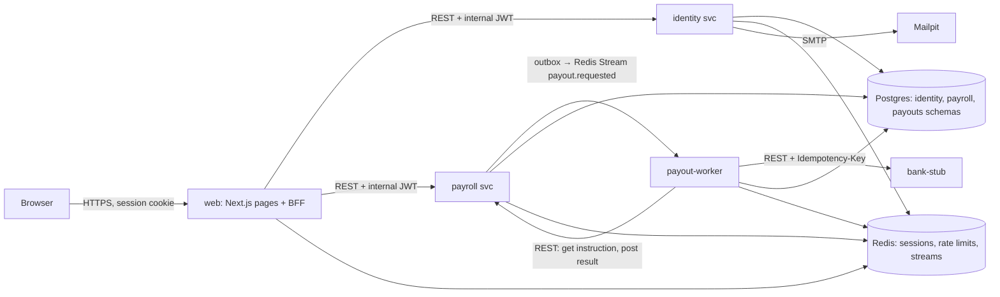
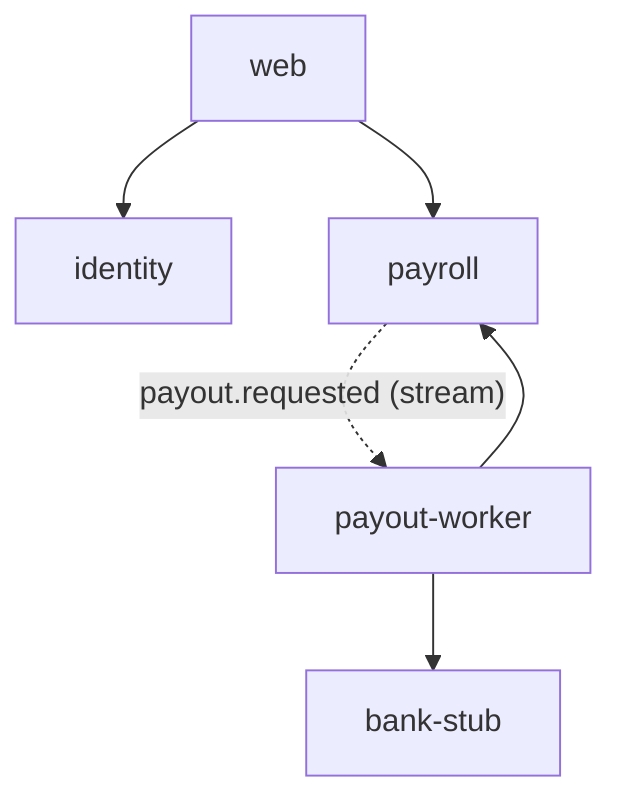

# Architecture plan: PayRun

Status: v1.3, 2026-11-10 (v1.2 accepted 2026-11-10: the user signed off the service map, the J1–J5 scope and all ADRs; v1.3 folds in spec decisions C46–C63 after S1–S7) · Repo: `/Users/danc/Repos/FinApp` (remote `github.com/Positron00/FinApp`, public) · First release: 0.1.0 · Specs: `docs/specs/payrun-0.1/` (aligned 2026-11-10, through C63)

## 1. Summary

PayRun is payroll for small and medium businesses. A company's payroll admins keep an employee
list (salaried or hourly, paid every two weeks or monthly). Each pay period they create a pay run,
enter hours for hourly staff, calculate it, and review the totals and payslips. Then an approver
approves the run, and each employee's net pay goes out as a separate payout to a simulated bank.
The run ends as `paid` or `partially_failed`, and failed payouts can be fixed and retried.



**What makes this harder than it looks:**

- **Money must be exact.** All amounts are integer cents, rates are basis points, and the rounding rules are fixed and tested ([ADR 0006](../adr/0006-money-and-rounding.md)).
- **Nobody is paid twice**, even when the worker crashes partway through a payout, a message is delivered twice, or a retry overlaps a late result. This rests on: one bank idempotency key per attempt (with a persistent ledger at the bank); checking the current attempt on every delivery; results applied only to the current attempt; uncertain outcomes never treated as final; and retries allowed only after the bank has definitely rejected the previous attempt ([ADR 0003](../adr/0003-payout-flow.md)).
- **Every payout must end in a final state** (paid or failed), so a run can always finish. That needs a bounded retry budget, a dead-letter queue, and an alert for stuck payouts.
- **Approval must be attributable** to a named person: built-in accounts, an audit trail, and optionally a rule that the person who prepared a run can't approve it ([ADR 0002](../adr/0002-sign-in-and-roles.md), [ADR 0005](../adr/0005-four-eyes-approval.md)).
- **The data is sensitive.** Bank account numbers are encrypted at rest and never returned in full; salaries never appear in logs ([ADR 0004](../adr/0004-bank-details-at-rest.md)).

## 2. App brief

| Item | Answer |
| --- | --- |
| What | Payroll MVP: employees, pay runs, calculation, approval, simulated payouts, payslips |
| For whom | Payroll admins and approvers at small and medium businesses. One seeded demo company in 0.1.0; every row still carries `company_id` |
| Scale | ≤ 50 staff users per company, ≤ 500 employees per company, about 5 req/s typical and 20 req/s peak at the BFF |
| Data sensitivity | High: personal and financial data (names, emails, salaries, bank account numbers). No tax IDs are collected in 0.1.0 |
| Availability | 99.5% monthly for the BFF journeys. Payouts are asynchronous: a 500-employee run should be fully settled (all payouts final) within 60 s at p95 |
| External APIs | None real. A **bank-stub** service simulates a payment processor (idempotent transfers, a configurable failure rate, forced failure for accounts ending `0000`). No LLM |
| Sign-in | **Pattern A, built-in accounts** (user decision, 2026-11-10). Invite-only, with no self sign-up ([ADR 0002](../adr/0002-sign-in-and-roles.md)) |
| Constraints | Built with the fullstack-app skill end to end. Local Docker on Apple silicon. Public GitHub repo, so nothing sensitive is committed. Port base `APP_PORT_BASE=4100` (Grafana already uses 3000 on this machine) |
| Out of scope (0.1.0) | Real tax tables or filing, multiple states or countries, benefits, time off, contractors, overtime, real bank rails, more than one company, self sign-up, email change, payslip PDF, employee self-service, 27-period years, holiday or weekend pay-date adjustment, statutory retention rules, a void endpoint at the bank, staff-user reactivation, changing a run's employee set. (Employee reactivation is in scope.) |

### 2.1 Domain rules that shape the design

- **Periods and dates.** All period dates are calendar `date` values in the company's timezone (`company_settings.timezone`, default `America/New_York`). No timestamps are used for periods.
  - **Monthly:** the period is a calendar month; `period_start` must be the 1st; `period_index` is the month (1–12); `pay_date` = `period_end`.
  - **Biweekly:** `period_start` must fall on the company's `biweekly_anchor` (default 2026-01-05, a Monday) plus a multiple of 14 days; `period_end` = start + 13 days; `pay_date` = `period_end`; `period_index` per [ADR 0006](../adr/0006-money-and-rounding.md).
  - Weekends and holidays aren't adjusted (out of scope).
- **Snapshots.**
  - Creating a run snapshots the active employees on the schedule (name, type, pay basis).
  - Calculating uses the snapshot and the hours entered. Later employee edits don't change a calculated or approved run; to pick them up, delete the run and recreate it while it's still draft or calculated.
  - Calculating snapshots `tax_bps` and `retirement_bps` onto the run, so the stored totals can always be reproduced.
  - Approving snapshots each employee's encrypted bank details onto attempt 1 (`payout_attempts.bank_snapshot_enc`). A retry snapshots the current employee record onto the new attempt.
  - An employee deactivated after a run was created stays in that run.
  - Creating a run rejects an employee whose days are already covered by another run that hasn't been deleted: 409 `employee_in_overlapping_run`, for example after a schedule change.
- **Bounds** (422 when exceeded):
  - salary: 0 < `annual_salary_cents` ≤ 1,000,000,000;
  - rate: 0 < `hourly_rate_cents` ≤ 100,000;
  - hours: 0 ≤ hours ≤ 33,600 hundredths per biweekly period (336 h), and ≤ 74,400 per monthly period (744 h).

  A payslip with net = 0 gets a payout marked `paid` with `no_transfer = true`, and no bank call.
- **Run status rule.**
  - Approve records `approved_by` and `approved_at`, and in the same transaction sets the run to `processing`, or straight to `paid` if every payout is `no_transfer`. So `approved` is an instant, recorded by `approved_at`, rather than a status a run rests in. (Brief deviation, noted: the lifecycle reads draft → calculated → processing → paid | partially_failed.)
  - After that, the run status is a pure function of its payouts: `processing` while any payout is `requested` (its current attempt is `requested`, `indeterminate` or `needs_operator`); otherwise `paid` if every payout is `paid`; otherwise `partially_failed`.
  - The status is recomputed under the `pay_runs` lock on every result and retry. `processing_since` is set whenever the run enters `processing`.
  - A property test checks that the stored status always equals this function.
- **Concurrency.** Every run mutation (hours, calculate, approve, delete, retry, result) runs `SELECT … FOR UPDATE` on the `pay_runs` row first, so state changes on one run are serialised. The approve and result updates are also conditional on the expected status (belt and braces).
- **Maintenance.** Each service runs a periodic in-process maintenance task (every 60 s; one replica at a time via a Postgres advisory lock).
  - **All services:** purge expired tokens, sent outbox rows, expired idempotency keys and old `processed_events` (retention in §6).
  - **payroll re-publish:**
    - It re-publishes `payout.requested` for an attempt that is `requested` or `indeterminate` when `now − last_published_at` exceeds its backoff (`PAYOUT_REPUBLISH_AFTER_S` × 2^(publish_count−1), capped at `PAYOUT_REPUBLISH_MAX_BACKOFF_S`), and the attempt has no unsent outbox row.
    - Each re-publish writes a **new outbox row with a fresh UUIDv7 `event_id`** and `data.republish_seq` = `publish_count`.
    - The worker's gate is the instruction check, not `processed_events` or `disbursements`. A `done` disbursement never blocks a new event; the upsert resets it to `submitting`.
    - After `PAYOUT_REPUBLISH_MAX` (10) re-publishes, or when the worker reports `poison`, the attempt becomes `needs_operator`. Re-publishing stops, the UI shows "blocked", and the runbook covers it.
  - **payroll purge:** bank details of deactivated employees (§6).
  - **identity:** fail emails after 10 send attempts.
  - **Gauges are separate from this task.** `payroll_payouts_stuck` and `payroll_runs_processing_oldest_age_seconds` are computed by every replica with a DB query at metric collection (OTel observable callbacks, 15 s export), so no replica exports a stale value. Alerts use `max()`.
- **Redis unavailable:**
  - the BFF's session lookup returns 503 `service_unavailable`;
  - rate limiting fails **closed** for login, reset and invite-accept (503), and **open** for authenticated per-session and per-caller limits, counted in `rate_limiter_errors_total`;
  - `/readyz` fails on every component that uses Redis;
  - the outbox keeps rows and the relay catches up afterwards.
- **Data loss in Redis** (failover, trim, FLUSHALL) is recovered by the re-publish above. The outbox and payroll's tables are the system of record, not the stream ([ADR 0003](../adr/0003-payout-flow.md)).

### 2.2 Configuration (main keys; full list in the low-level designs and `.env.example`)

| Key | Default (dev) | uat / prod | Notes |
| --- | --- | --- | --- |
| `APP_PORT_BASE` | 4100 | n/a | Compose host ports |
| `ENV` | dev | uat / prod | Drives the startup checks |
| `PAYOUT_MAX_DELIVERIES` | 5 | 5 | Deliveries per message. After that, with the bank unreachable, the worker reports the attempt `indeterminate` and ACKs (payroll re-publishes later). With payroll unreachable, or a poison message, it goes to the DLQ |
| `PAYOUT_REPUBLISH_AFTER_S` | 360 | 360 | Base re-publish backoff. A startup check requires it to be > `PAYOUT_MAX_DELIVERIES` × claim idle (s) + `BANK_TOTAL_DEADLINE_S` |
| `PAYOUT_REPUBLISH_MAX_BACKOFF_S` / `PAYOUT_REPUBLISH_MAX` | 900 / 10 | same | Backoff cap; re-publishes before `needs_operator` |
| `PAYOUT_CLAIM_MIN_IDLE_MS` | 60000 | 60000 | XAUTOCLAIM idle time. A startup check requires it to be > `BANK_TOTAL_DEADLINE_S` + 2 × `PAYOUT_PAYROLL_CALL_DEADLINE_S` + 10 s |
| `PAYOUT_MARK_REJECTED_MIN_WAIT_S` | 120 | 120 | Shared timing key: `mark_rejected` is refused with 409 `resolve_too_early` until this long after the attempt became `needs_operator`. A startup check (payroll) requires it to be > `BANK_TOTAL_DEADLINE_S` + 2 × `PAYOUT_PAYROLL_CALL_DEADLINE_S` + 10 + 30 s (spec C48) |
| `PAYOUT_CONSUMER_GC_IDLE_S` | 3600 | 3600 | Worker maintenance deletes stream consumers idle this long with no pending entries (`XGROUP DELCONSUMER`; spec C47) |
| `BANK_TOTAL_DEADLINE_S` | 15 | 15 | Total deadline for one bank call, including retries |
| `PAYOUT_PAYROLL_CALL_DEADLINE_S` | 5 | 5 | Total deadline per worker → payroll call, including retries |
| `BANK_KEY_SAFE_WINDOW_S` | 86400 | provider's key retention | Past this age, an attempt is re-driven only via GET by key, never a new POST ([ADR 0003](../adr/0003-payout-flow.md)) |
| `DB_STATEMENT_TIMEOUT_MS` / `DB_POOL_TIMEOUT_S` | 2000 / 2 | same | Postgres statement and pool timeouts. A timeout returns 503 `db_timeout` |
| `REDIS_SOCKET_TIMEOUT_MS` / `PAYOUT_XREAD_BLOCK_MS` | 500 / 5000 | same | Redis client timeout; XREADGROUP block |
| `STREAM_MAXLEN` | 100000 | 100000 | Approximate MAXLEN on `stream:payout.requested` |
| `PAYROLL_VALIDATE_EVENTS` | true | true | payroll's internal endpoints and outbox relay validate envelopes against the JSON Schema (spec C60, C63) |
| `MAINTENANCE_INTERVAL_S` / `PAYOUT_STUCK_AFTER_S` | 60 / 600 | same | Maintenance tick; threshold for `payroll_payouts_stuck` |
| `BREAKER_FAILURES` / `BREAKER_RESET_S` | 5 / 30 | same | Circuit breaker per target |
| `RETENTION_OUTBOX_DAYS` / `RETENTION_PROCESSED_EVENTS_DAYS` / `RETENTION_TOKENS_DAYS` / `RETENTION_BANK_DETAILS_DAYS` / `IDEMPOTENCY_TTL_H` | 7 / 30 / 7 / 30 / 24 | same | Purge windows (§6) |
| `TRUSTED_PROXY_HOPS` | 0 | 1 | Client-IP extraction at the BFF: entry `n − hops` of `X-Forwarded-For`, or the right-most entry for 0 (dev). uat and prod refuse values below 1 (`config.invalid`, exit 2; spec C62) |
| `COMPANY_ID` | fixed dev UUID | per environment | The seeded company (0.1.0 is single-company) |
| `PAYOUT_CONCURRENCY` | 16 | 16 | Messages handled at once per worker replica (2 replicas in Kubernetes; `terminationGracePeriodSeconds: 75`) |
| `PAYOUT_MAX_ATTEMPTS` | 5 | 5 | Maximum attempts per payout, **including the first**. A retry when `current_attempt = 5` returns 409 `retry_limit_reached` |
| `BANK_BASE_URL` | `http://bank-stub:8000` | stub (uat) / provider (prod) | The prod startup check refuses a URL that points at bank-stub or a placeholder |
| `BANK_STUB_FAILURE_RATE` | 0.05 | 0.05 (uat) | Deterministic per idempotency key |
| `BANK_STUB_LATENCY_MS` | 20 | 20 | |
| `AUTH_LOGIN_LIMIT_ACCOUNT` / `_IP` | 5 / 20 per 15 min | same | Raised in the test env (`compose.test.yaml`). An integration test proves the production values lock out |
| `SESSION_IDLE_TTL_S` / `SESSION_ABS_TTL_S` | 43200 / 604800 | same | |
| `SESSION_ROLE_RECHECK_S` | 60 | 60 | The BFF re-reads `/v1/users/me` when the cached roles are older than this; a `roles_version` mismatch or inactive status kills the session |
| `INVITE_TTL_H` / `RESET_TTL_H` | 72 / 1 | same | |
| `BFF_RATE_LIMIT_SESSION` / `_IP` | 120 / 300 per min | same | Raised in the test env, so k6 at 30 req/s from one IP isn't throttled; an integration test proves the production values limit |
| `SERVICE_RATE_LIMIT_USER` / `_WORKER` | 600 / 6000 per min | same | Per-caller limit in services as defense in depth. The key is `(iss, sub)`, so per user for web tokens and per worker for `service:payout-worker`. `service:web` (public flows) is exempt and limited per IP instead (spec R18, C17) |
| `EMAIL_MAX_ATTEMPTS` | 10 | 10 | The identity relay then marks the email `failed` (alert `EmailOutboxStuck`) |
| `SMTP_HOST` / `SMTP_PORT` / `SMTP_STARTTLS` / `SMTP_USERNAME` / `SMTP_PASSWORD` | mailpit / 1025 / false / unset / unset | provider | Unprefixed infrastructure keys, like `DB_*` (spec C49) |
| `OTEL_TRACES_SAMPLER` | parentbased_always_on | same | Apps send every span; prod keeps errors, slow traces and 10% of the rest at the Collector (`tail_sampling`) |
| `company_settings.require_dual_approval` | true | true | Per company, audited ([ADR 0005](../adr/0005-four-eyes-approval.md)) |

### 2.3 Cost and migration

- **Cost:** there are no paid external APIs or LLMs. Hosting cost is out of scope for 0.1.0 (no deployment target chosen).
- **Migration:** this is a greenfield repo with no existing data or deployments. Schema changes after 0.1.0 are expand-then-contract.

## 3. User journeys

- **J1 Access.**
  1. An admin invites a colleague by email and chooses their roles.
  2. The invitee opens the link (from Mailpit locally), sets a password and lands on the dashboard.
  3. Users sign out, and can reset a forgotten password.

  *Success:* the invitee is signed in with exactly the roles they were given, and every step is in the identity audit log.
- **J2 Company setup.**
  1. An admin sets the company's tax rate and retirement deduction rate.
  2. A payroll admin adds employees, salaried (annual salary) or hourly (rate), with a pay schedule (biweekly or monthly) and bank details.
  3. They edit or deactivate employees.

  *Success:* the employee list shows each employee's pay basis and only the last four digits of their bank account; changes appear in the payroll audit log.
- **J3 Prepare a pay run.**
  1. A payroll admin creates a run for a schedule and period. All active employees on that schedule are included.
  2. They enter hours for hourly employees.
  3. They calculate the run.
  4. They review the summary (gross, tax, deductions, net and the funding required) and each payslip.

  *Success:* every payslip satisfies gross = net + tax + deductions, the funding total equals the sum of net pay, and only one run exists per schedule and period.
- **J4 Approve and pay.**
  1. An approver approves a calculated run, which locks it.
  2. Payouts are processed in the background, and the run page shows live progress.
  3. The run ends `paid`, or `partially_failed` if any payout failed.

  *Success:* the run can't be approved twice, every payout ends paid or failed, each payout settles at most once at the bank, and a 500-employee run settles within 60 s.
- **J5 Recover failed payouts.**
  1. The approver sees which payouts failed and why.
  2. A payroll admin fixes the employee's bank details.
  3. The approver retries the failed payout.

  *Success:* the retry pays the corrected account, the run moves to `paid` once nothing has failed, and the history shows every attempt.

## 4. Domains and service map

**Domains** (nouns that own data and rules): User, Credential, Invite and Reset token, Role, Auth audit · Company settings, Employee, Bank details, Pay run, Payslip, Payout, Payroll audit · Disbursement attempt · Bank transfer (external).

| Service | Owns (data) | Exposes (API) | Publishes / consumes | Calls (sync, timeout, fallback) | Why separate (and the merge alternative) |
| --- | --- | --- | --- | --- | --- |
| **web** (Next.js BFF) | Redis `web:sess:*`, `web:user-sess:*`, `web:rl:*` | Pages; `/api/*` BFF routes | — | identity and payroll: 3 s per attempt, covering connect and read (calculate and approve: 10 s; spec C62); GETs retried twice on 429/502/503/504; breaker per target. Fallback: an error page or toast with the mapped message, never stale money data | Default stack: the only public entry |
| **identity** | schema `identity`: `users`, `credentials`, `invites`, `password_resets`, `audit_log`, `email_outbox` | `/v1/auth/*`, `/v1/users/*`, `/v1/invites/*`, `/v1/audit-log` | — (sends email from its own `email_outbox` through an in-process relay) | SMTP (Mailpit) through the resilient client's breaker and metrics (`external_requests_total{provider="smtp"}`): 5 s timeout, retried by the relay with backoff up to `EMAIL_MAX_ATTEMPTS`, then `failed`. Fallback: the email stays queued; invites and resets still succeed, and an admin can re-send an invite (`POST /v1/invites/{id}/resend`) | Credentials have a different blast radius from payroll data; this is pattern A's standard identity service. *Merge alternative:* auth tables inside payroll, which would mix credential handling with money logic and give payroll's DB role access to password hashes. Rejected |
| **payroll** | schema `payroll`: `company_settings`, `employees`, `pay_runs`, `pay_run_hours`, `payslips`, `payouts`, `payout_attempts`, `audit_events`, `outbox`, `idempotency_keys` | `/v1/company/settings`, `/v1/employees*`, `/v1/pay-runs*`, `/v1/audit-events`, internal `/v1/internal/payouts/*` | publishes `payout.requested.v1` (outbox) | — (no outbound sync calls) | The core domain: all money rules and the run state machine in one place, with one transaction per state change |
| **payout-worker** | schema `payouts`: `disbursements`, `processed_events` | `/livez`, `/readyz` only | consumes `payout.requested.v1` (group `payout-worker`) | payroll internal API: connect 1 s, read 2 s, 3 retries on 429/502/503/504, connect errors and read timeouts (both calls are idempotent) within `PAYOUT_PAYROLL_CALL_DEADLINE_S` (5 s), breaker. bank-stub: connect 1 s, read 5 s, 3 retries on 429/502/503/504 and timeouts, with the same Idempotency-Key, within `BANK_TOTAL_DEADLINE_S` (15 s), breaker. Fallback: leave the message pending, so it's redelivered through XAUTOCLAIM; after `PAYOUT_MAX_DELIVERIES`, report the attempt `indeterminate` (**never** `failed`) and ACK. payroll then re-publishes the same attempt with the same key until the bank gives a definite answer | Background work with its own scaling and failure profile. It isolates the slow, unreliable bank dependency from user requests. *Merge alternative:* a background task inside payroll, which would tie bank latency to API latency and make crash-mid-payout testing harder. Rejected |
| **bank-stub** | schema `bank_stub`: `transfers` (`UNIQUE(idempotency_key)`, written with `INSERT … ON CONFLICT DO NOTHING RETURNING`, so it stays idempotent across restarts, replicas and concurrent same-key POSTs) | `POST /v1/transfers`, `GET /v1/transfers/{key}`, `/livez`, `/readyz` | — | — | Stands in for an external processor so the resilient client, Toxiproxy faults and double-payment checks are real. It would be replaced by a real provider adapter later; the adapter contract is POST with an idempotency key plus GET by key. Runs in the Compose `core` profile and in the dev and uat Kubernetes overlays, never in prod ([ADR 0001](../adr/0001-service-map.md)) |



**Checks:**
- **No synchronous cycles.** payroll never calls the worker; it only publishes to it.
- **Hop depth.** The longest synchronous chain is 2 hops (browser → web → service). The worker's chain starts from a queue message, and worker → payroll is a separate chain.
- **Async placement.** Everything that doesn't need an answer within the request (payouts, email) is asynchronous.
- **Writes go through the owner.** The worker changes payroll data only through payroll's API, with `Idempotency-Key: <event_id>:<outcome>` on results.

## 5. Journeys through the system

### J1 Access (invite → accept → sign in)

```mermaid
sequenceDiagram
  participant A as Admin browser
  participant W as web BFF
  participant I as identity
  participant M as Mailpit
  A->>W: POST /api/users/invite {email, roles}
  W->>I: POST /v1/users/invite (JWT sub=admin)
  I->>I: users(pending) + invite + email_outbox (1 tx); the relay generates the token at send (R17)
  I-->>W: 201
  I--)M: relay sends invite email
  Note over A: Invitee opens link /accept#token=… (fragment: never sent to servers, logs or spans)
  A->>W: POST /api/auth/accept {token, password}
  W->>I: POST /v1/invites/accept (JWT sub=service:web)
  I-->>W: 200 {user}
  W->>W: create Redis session, rotate id, set cookie
```

**Failure paths:**
- An expired or used token returns 400 `invite_invalid`.
- **Token handling:** tokens never appear in query strings. The redactor also masks any `token` parameter in span and log attributes, and a test checks that Loki and Tempo never contain a token.
- If identity is down, the BFF returns 503 `service_unavailable` and the page says "try again".
- A weak password returns 422 `password_too_weak`.
- If SMTP is down, the email stays in `email_outbox`; the invite returns 201 and is marked "email pending".
- Sign-in has its own failure modes:
  - a wrong password returns 401 `invalid_credentials`, which doesn't reveal whether the account exists;
  - too many attempts return 429 with `Retry-After`;
  - a locked account (and an unknown email past the same limits) returns 429 `rate_limited` with `Retry-After`, so the response doesn't reveal whether the account exists.

### J2 Company setup

The browser calls the BFF `/api/employees` routes, the BFF calls payroll `/v1/employees`, and
payroll writes `employees` and `audit_events` in one transaction. On the way in, bank details are
encrypted with AES-256-GCM (keys `PAYROLL_FIELD_KEYS`, active kid `PAYROLL_FIELD_ACTIVE_KID`); on the way out, only `account_last4` is
returned.

**Failure paths:** 422 for validation, 409 `employee_email_taken`, 404 `employee_not_found`, and 403 `forbidden_role` when the role is missing.

### J3 Prepare a pay run

`POST /v1/pay-runs {schedule, period_start}` derives `period_end`, `pay_date`, `period_index` and
`periods_per_year`. It snapshots the active employees on that schedule into payslip rows with
status `pending`.

- `PUT /v1/pay-runs/{id}/hours` saves hours for hourly employees. It's allowed only in `draft` or `calculated`, and moves the run back to `draft`.
- `POST /v1/pay-runs/{id}/calculate` computes every payslip in pure domain code, writes the payslips and totals, and sets the run to `calculated`. It records `calculated_by`.

**Failure paths:**
- 409 `pay_run_exists` when a run already exists for that company, schedule and period.
- 409 `pay_run_locked` after approval.
- 422 `hours_missing` when an hourly employee has no hours.
- 409 `no_employees` when nobody is on that schedule.

### J4 Approve and pay

```mermaid
sequenceDiagram
  participant U as Approver browser
  participant W as web BFF
  participant P as payroll
  participant R as Redis stream
  participant X as payout-worker
  participant K as bank-stub
  U->>W: POST /api/pay-runs/{id}/approve (Idempotency-Key)
  W->>P: POST /v1/pay-runs/{id}/approve
  P->>P: UPDATE pay_runs SET status='processing', approved_by, approved_at, processing_since WHERE status='calculated' (+ dual-approval check)<br/>INSERT payouts + payout_attempts(attempt=1, requested, last_published_at) + outbox rows + audit (1 tx)
  P-->>W: 200 {status: processing}
  P--)R: outbox relay XADD payout.requested (traceparent in envelope)
  R--)X: XREADGROUP
  X->>X: processed_events check (skip if seen); upsert disbursement (payout_id, attempt) = submitting
  X->>P: GET /v1/internal/payouts/{id}/instruction?attempt=n (EVERY delivery)
  P-->>X: 200 {amount_cents, bank} only if attempt n is current AND requested|indeterminate, else 409 attempt_not_current
  X->>K: POST /v1/transfers (Idempotency-Key = payout_id:attempt, amount from instruction)
  K-->>X: settled | rejected(reason)  (same answer for a repeated key)
  X->>P: POST /v1/internal/payouts/{id}/result {attempt, outcome} (Idempotency-Key = event_id:outcome)
  P->>P: attempt → settled|rejected|indeterminate (only if current and requested|indeterminate, or needs_operator for a definite settled|rejected; already final → 200 with stored outcome)<br/>payout → paid|failed; run status recomputed (§2.1)
  X->>X: disbursement = done, processed_events insert (1 tx), XACK
  U->>W: GET /api/pay-runs/{id} (polled every 2 s by TanStack Query)
```

**Failure paths:**
- **Bank answer classification:** only HTTP 2xx with body `status: rejected` and a `reason` counts as a definite rejection. Everything else counts as "no answer" and goes down the `indeterminate` path: timeouts, 5xx, 429, 409, 401/403, 404, 422 and malformed bodies ([ADR 0003](../adr/0003-payout-flow.md) e).
- **Second approve:** the conditional update affects no rows, so payroll returns 409 `pay_run_not_approvable`. A repeat of the same `Idempotency-Key` gets the original 200 instead.
- **Four-eyes violation:** 403 `approver_must_differ` ([ADR 0005](../adr/0005-four-eyes-approval.md)).
- **Bank details missing:** 409 `employee_bank_details_missing` when an employee in the run has purged or missing bank details.
- **Redis down:** outbox rows stay unsent and the relay catches up after recovery (alert `OutboxStuck`).
- **Worker crashes before the bank call:** the message is redelivered and processed normally.
- **Worker crashes after the bank call but before the result:** the message is redelivered. The worker re-fetches the instruction, which is still current, and POSTs again with the same key. The bank's persistent ledger returns the original transfer, so no money moves twice, and the worker posts the result.
- **Bank slow or down, or the bank times out after it actually settled:** retries within the 15 s deadline, then the breaker opens and the message stays pending. After `PAYOUT_MAX_DELIVERIES`, the worker posts `indeterminate` and ACKs.
  - An indeterminate attempt is **not final** and **can't be retried**.
  - payroll re-publishes it (same `payout_id` and `attempt`, so the same bank key) every `PAYOUT_REPUBLISH_AFTER_S` until the bank answers definitely.
  - The run stays `processing`, shown as "awaiting bank" in the UI. `PayoutsStuck` and `PayoutSettlementSlow` fire.
  - When the bank is unreachable, the time to `indeterminate` is about `PAYOUT_MAX_DELIVERIES` × 60 s of claim idle time; re-publish then follows its backoff. The 60 s SLO covers the healthy-bank path only ([ADR 0012](../adr/0012-slos.md)).
- **Redelivered old attempt after a retry:** for example, attempt 1 was rejected and recorded, the worker crashed before ACK, and attempt 2 then settled.
  - On redelivery, the instruction call returns 409 `attempt_not_current`, so the worker never calls the bank. It marks the disbursement done and ACKs.
  - If the instruction's amount doesn't match the event's, the message is poison. The worker reports `poison` (the attempt becomes `needs_operator`, so re-publishing stops), sends the message to the DLQ and ACKs.
- **Result for a current attempt that's already final** (`indeterminate` arriving after `settled`, or a duplicate `settled`): payroll returns 200 with the stored final outcome and changes nothing; the worker ACKs. `settled` arriving after `indeterminate` applies normally, because indeterminate isn't final. Result Idempotency-Keys are `<event_id>:<outcome>`, so a later definite answer on the same event isn't masked by a stored `indeterminate` response.
- **Attempt older than `BANK_KEY_SAFE_WINDOW_S`:** the worker first calls `GET /v1/transfers/{key}`. If found, it uses that transfer. If not found, the attempt becomes `needs_operator` and the worker never POSTs, because the provider may have forgotten the key.
- **payroll down when the worker needs the instruction or reports a result:** the message stays pending and is retried. After the budget it goes to `payout.requested.dlq` and alert `PayoutDLQ` fires. The attempt is still `requested`, so payroll's re-publish redrives it after recovery. `payroll_payouts_stuck` (attempts non-final for more than 10 min) raises `PayoutsStuck`.
- **Redis loses the stream** (failover, trim): payroll's re-publish redrives every non-final attempt ([§2.1](#21-domain-rules-that-shape-the-design)).
- **Late result for an old attempt:** payroll returns 409 `attempt_not_current`; the worker treats it as final and ACKs.
- **Late definite answer for a blocked attempt:** a `settled` or `rejected` result for a current `needs_operator` attempt applies, because the bank's answer wins (spec R7, C42; [ADR 0003](../adr/0003-payout-flow.md) c). An `indeterminate` or `poison` report for it returns 200 and changes nothing.
- **Concurrent retry and late result:** both lock the `pay_runs` row. A retry is only possible after a definite `rejected`, and a late result for that attempt then finds it no longer current.

### J5 Recover failed payouts

1. A payroll admin PATCHes the employee's bank details (allowed while a run is in progress; the run's amounts stay locked).
2. The approver calls `POST /v1/pay-runs/{id}/payouts/{pid}/retry`.
   - Only a payout whose current attempt was **definitely rejected by the bank** (`failed`) can be retried. An `indeterminate` attempt never can.
   - The retry creates attempt n+1 (`payout_attempts` row), snapshots the current bank details, writes an outbox event, and moves the run back to `processing`.
   - With dual approval on, the retrier must not be the last editor of that employee's bank details. Otherwise 403 `approver_must_differ` ([ADR 0005](../adr/0005-four-eyes-approval.md)).
3. The flow continues as in J4.

**Failure paths:**
- 409 `payout_not_retryable` when the payout isn't failed, including indeterminate attempts.
- 409 `retry_limit_reached` when `current_attempt = PAYOUT_MAX_ATTEMPTS` (5, including the first).
- 403 `approver_must_differ` as above.
- 409 `employee_bank_details_missing` when the employee is inactive or their bank details were purged.

## 6. Data

All keys are UUIDv7, and every table has `created_at` and `updated_at` (timestamptz). Money is
`BIGINT` cents, rates are `INTEGER` basis points, and hours are `INTEGER` hundredths of an hour.
Each schema has a migrator role and a runtime role (`architecture.md` §6).

| Schema | Main tables | Personal data | Retention (0.1.0) |
| --- | --- | --- | --- |
| `identity` | `users` (email, name, roles[], roles_version, status, company_id), `credentials` (argon2id hash), `invites`/`password_resets` (token hash, expiry), `audit_log` (user_id, event, ip_hash = HMAC-SHA256 keyed with `AUDIT_IP_HASH_KEY`, at), `email_outbox` (recipient, template, token reference; the rendered body with the link is never stored) | email, name, IP hash | Users are deactivated, not deleted. Tokens are purged 7 days after expiry. Audit log 400 days. Sent and failed emails purged after 7 days |
| `payroll` | `company_settings` (incl. timezone, biweekly_anchor, require_dual_approval), `employees` (name, email, type, annual_salary_cents/hourly_rate_cents, schedule, bank_routing_enc, bank_account_enc, account_last4, bank_updated_by, bank_updated_at, status, deactivated_at), `pay_runs` (period, status, tax_bps, retirement_bps, require_dual_approval snapshot, totals, calculated_by, approved_by, approved_at, processing_since, first_final_at), `pay_run_hours`, `payslips` (snapshot of name and pay basis, gross/tax/deduction/net cents), `payouts` (one per payslip: current_attempt, status requested/paid/failed, no_transfer), `payout_attempts` (`UNIQUE(payout_id, attempt)`, status requested/indeterminate/needs_operator/settled/rejected, failure_reason, bank_reference, bank_snapshot_enc, requested_at, last_published_at, publish_count, needs_operator_at, final_at), `audit_events`, `outbox`, `idempotency_keys` | name, email, salary, bank details (encrypted) | Payroll records are kept (statutory retention is a post-0.1 ADR). **Bank details of deactivated employees are purged 30 days after deactivation**, if no attempt for them is non-final. The purge also nulls `bank_snapshot_enc` on their final attempts (maintenance task, with a test). Audit diffs for bank edits record only `account_last4` and the names of the changed fields. Sent outbox rows purged after 7 days. Idempotency keys expire after 24 h |
| `payouts` | `disbursements` (payout_id, attempt, company_id, status submitting/done, outcome, reason, bank_reference, last_event_id, deliveries), `processed_events` | none (no account numbers are stored by the worker) | processed_events 30 days; disbursements kept |
| `bank_stub` | `transfers` (id, idempotency_key unique, amount_cents, currency, account_last4, status, reason, bank_reference, timestamps) | last 4 digits only | dev and uat only; truncated by `stack.sh reset` |

- **Migrations:** Alembic per service, with the version table in the service's own schema. Changes are expand-then-contract only. A `migrate-<svc>` one-shot (Compose) or Job (Kubernetes) runs before the service starts.
- **Redis** (one instance, `noeviction` + AOF; **an ACL user per service**, each with PING and none with scripting, `SCAN` or `RANDOMKEY` (spec R12, C3, C63): web `~web:*`; identity `~identity:*`; payroll `~payroll:*` plus XADD on `stream:payout.requested`; payout-worker gets XREADGROUP, XACK, XAUTOCLAIM, XPENDING, XINFO, XGROUP CREATE and XGROUP DELCONSUMER on that stream (spec C27), and XADD and XINFO on the `.dlq`; it recreates its group on NOGROUP (after data loss); a read-only `exporter` user reads stream info. An integration test checks that web can't XADD; [ADR 0007](../adr/0007-data-stores.md)): `web:sess:*`, `web:user-sess:*`, `web:rl:*`, `identity:rl:*`, `payroll:rl:*`, `stream:payout.requested`, `stream:payout.requested.dlq`. Streams are written with `MAXLEN ~ 100000`, about 200× a full run.

## 7. APIs and events

All service paths are under `/v1`, every request needs an internal JWT with `aud` set to the
service name, and errors use the shared format (`architecture.md` §8). Exact request and response
models and error codes are written in the low-level designs (Step 2).

**identity** (`aud=identity`):

| Method | Path | Purpose | Caller and roles |
| --- | --- | --- | --- |
| POST | /v1/auth/login | Verify credentials, return the user and roles | `service:web` (public flow) |
| POST | /v1/auth/password-reset/request | Email a reset link (always 202) | `service:web` |
| POST | /v1/auth/password-reset/confirm | Set a new password and revoke sessions (the BFF clears `web:user-sess`) | `service:web` |
| POST | /v1/invites/accept | Set a password and activate the user | `service:web` |
| GET | /v1/users/me | Current user | any user |
| GET | /v1/users | List users | admin |
| POST | /v1/users/invite | Invite a user with roles | admin |
| POST | /v1/invites/{id}/resend | Re-send a pending invite (new token; the old one is revoked) | admin |
| PATCH | /v1/users/{id} | Change roles or status (deactivate) | admin (not on themselves) |
| GET | /v1/audit-log | Auth audit (cursor) | admin |

**payroll** (`aud=payroll`):

| Method | Path | Purpose | Roles |
| --- | --- | --- | --- |
| GET / PUT | /v1/company/settings | Company name, tax_rate_bps (0–5000), retirement_bps (0–2000) | GET any; PUT admin |
| GET / POST | /v1/employees | List (cursor, status filter) / create | GET any; POST payroll_admin |
| GET / PATCH | /v1/employees/{id} | Read / update (including bank details and deactivation) | GET any; PATCH payroll_admin |
| GET / POST | /v1/pay-runs | List / create a run (schedule, period_start) | GET any; POST payroll_admin |
| GET / DELETE | /v1/pay-runs/{id} | Summary with status and payout counts / delete (draft or calculated only) | GET any; DELETE payroll_admin |
| PUT | /v1/pay-runs/{id}/hours | Upsert hours for hourly employees | payroll_admin |
| POST | /v1/pay-runs/{id}/calculate | Calculate payslips and totals | payroll_admin |
| POST | /v1/pay-runs/{id}/approve | Approve (Idempotency-Key honoured) | approver |
| GET | /v1/pay-runs/{id}/payslips[/{payslip_id}] | Payslips | any |
| GET | /v1/pay-runs/{id}/payouts | Payouts with attempts and failure reasons | any |
| POST | /v1/pay-runs/{id}/payouts/{payout_id}/retry | Retry a failed payout | approver |
| POST | /v1/pay-runs/{id}/payouts/{payout_id}/resolve | Resolve a `needs_operator` attempt: `redrive` or `mark_rejected` (PAY-502) | approver |
| GET | /v1/audit-events | Payroll audit (cursor) | admin |
| GET | /v1/internal/payouts/{id}/instruction?attempt=n | Amount and decrypted bank details. 200 only if attempt n is current and `requested`/`indeterminate`; otherwise 409 `attempt_not_current`. The payout must belong to the token's `cid` | caller `service:payout-worker` only |
| POST | /v1/internal/payouts/{id}/result | Record an attempt's outcome: `settled`, `rejected` (with a reason), `indeterminate` or `poison`. Idempotency-Key = `<event_id>:<outcome>`. 409 `attempt_not_current` for stale attempts; 200 with the stored outcome if the current attempt is already final | caller `service:payout-worker` only |

**bank-stub:**
- `POST /v1/transfers {amount_cents, currency, routing, account}` with `Idempotency-Key` returns `{transfer_id, status: settled|rejected, reason, bank_reference}`: 201 when new, 200 on a replay. The same key always returns the same result.
- `GET /v1/transfers/{key}` returns the transfer, or 404. It's part of the provider-adapter contract: used by tests and by operators reconciling indeterminate attempts.
- The ledger is persisted in the `bank_stub` schema with `UNIQUE(idempotency_key)`, so idempotency survives restarts, replicas and concurrent POSTs.
- It authenticates the caller with a static API key header (`BANK_STUB_API_KEY`), as a real provider would.

**Events:**

| Type | Version | Producer | Consumers | `data` summary |
| --- | --- | --- | --- | --- |
| `payout.requested` | 1 | payroll (outbox) | payout-worker | `payout_id`, `pay_run_id`, `company_id`, `attempt`, `amount_cents`, `currency` (no bank details, no names) |

The envelope is `{event_id, type, version, occurred_at, producer, traceparent, data}`, with
JSON Schema files in `contracts/events/payout.requested.v1.json`. Payout results go back through
payroll's internal API rather than as events ([ADR 0003](../adr/0003-payout-flow.md)).

## 8. Identity and security

- **Sign-in:** pattern A, invite-only (`auth.md` §A).
  - Passwords are argon2id, at least 12 characters.
  - Sign-in is limited per account (5 per 15 min) and per IP (20 per 15 min), with lockout backoff; the test environment raises these limits.
  - Sessions are in Redis with a 12 h idle and 7 day absolute TTL. They're rotated at sign-in and revoked after a password reset, a role change or deactivation.
  - Revocation doesn't depend on the BFF clearing `web:user-sess` alone. `requireSession` re-reads `/v1/users/me` when the cached roles are older than `SESSION_ROLE_RECHECK_S` (60 s), and ends the session on a `roles_version` mismatch or inactive status. So a demotion takes effect within 60 s at most while identity is reachable. If identity is unreachable, cached roles are kept for up to `SESSION_RECHECK_GRACE_S` (300 s), then the BFF returns 503 (spec C37).
  - **First owner and company (every environment):** a one-shot CLI, `python -m identity.bootstrap_owner --email … --company-id …`, runs as a Compose one-shot or Kubernetes Job with the identity migrator credentials. It works only while `users` is empty, and emails an invite link. `--if-empty` makes a re-run a no-op (exit 0); `--password-env VAR` (dev only) creates an active owner without email (spec R16). A payroll migration seeds the `company_settings` row for the configured `COMPANY_ID`. `scripts/seed.py` (dev and CI only) then invites the other users through the admin API and accepts the invites using tokens read from Mailpit's API.
- **Roles and permissions** (a user may hold several roles; the seeded owner holds all three):

  | Action | admin | payroll_admin | approver |
  | --- | --- | --- | --- |
  | Invite users, change roles, view auth audit | ✓ | | |
  | Edit company settings, view payroll audit | ✓ | | |
  | Manage employees and bank details | | ✓ | |
  | Create, edit hours, calculate, delete runs | | ✓ | |
  | Approve runs, retry payouts, resolve blocked payouts (PAY-502) | | | ✓ (with dual approval on: not the calculator, nor the last bank-detail editor of an affected employee; ADR 0005) |
  | View runs, payslips, employees (including salaries) | ✓ | ✓ | ✓ |

  All three roles can see salaries; this is recorded as a decision in [ADR 0002](../adr/0002-sign-in-and-roles.md).

- **Internal JWT:** EdDSA. Claims `iss`, `aud`, `sub`, `name` (user tokens), `roles`, `cid` (company id), `sid`, `iat`, `exp` (60 s), `jti`. Public-flow tokens carry `cid = COMPANY_ID`; worker tokens carry `roles: []` and no `sid`.
  - **Keys are bound to issuers.** `INTERNAL_JWT_PUBLIC_KEYS` is JSON `{kid: {"iss": "web"|"payout-worker", "pem": …}}`, and the verifier rejects a token whose `iss` doesn't match its kid's bound issuer. So the worker's key can't mint `iss=web` tokens, and a test checks that.
  - payroll's keyset has the web and worker keys. It accepts `iss=web` on public routes, and `iss=payout-worker` only on `/v1/internal/*`, with `sub=service:payout-worker`.
  - identity's keyset has web keys only.
  - The worker's token carries `cid` taken from the event's `company_id`.
  - Every query is scoped by `cid` from the token, never by input.
- **BFF:**
  - an Origin check on every mutation;
  - a rate limit per session (120/min) and per IP (300/min), backed by Redis, with the client IP taken from `TRUSTED_PROXY_HOPS`;
  - request bodies limited to 64 KB at the BFF and 256 KB at services;
  - nonce-based CSP ([ADR 0009](../adr/0009-csp.md)), `X-Frame-Options: DENY`, `nosniff`, `Referrer-Policy: same-origin`, and HSTS in prod.
- **Secrets inventory:**

  | Secret | Purpose | dev / CI | uat / prod |
  | --- | --- | --- | --- |
  | `POSTGRES_PASSWORD` | Postgres superuser for the bootstrap | `.env` (`dev-env.sh`) | Managed DB admin, via External Secrets |
  | `IDENTITY_DB_MIGRATOR_PASSWORD`, `IDENTITY_DB_PASSWORD` (also `PAYROLL_*`, `PAYOUTS_*`) | Per-service DB roles | `.env` | External Secrets |
  | `REDIS_ADMIN_PASSWORD`, `REDIS_WEB_PASSWORD`, `REDIS_IDENTITY_PASSWORD`, `REDIS_PAYROLL_PASSWORD`, `REDIS_PAYOUT_WORKER_PASSWORD` | Redis default user and per-service ACL users | `.env` | External Secrets (managed Redis ACLs) |
  | `BANK_STUB_DB_PASSWORD`, `BANK_STUB_DB_MIGRATOR_PASSWORD` | bank-stub DB roles (dev and uat only) | `.env` | External Secrets (uat) |
  | `INTERNAL_JWT_PRIVATE_KEY`, `INTERNAL_JWT_KID` | BFF token signing | `.env` | External Secrets |
  | `PAYOUT_WORKER_JWT_PRIVATE_KEY`, `PAYOUT_WORKER_JWT_KID` | Worker token signing | `.env` | External Secrets |
  | `INTERNAL_JWT_PUBLIC_KEYS` | Issuer-bound keyset, **one per service** (identity: web keys only; payroll: web and worker keys) | `.env` | ConfigMap per service (public keys) |
  | `PAYROLL_FIELD_KEYS`, `PAYROLL_FIELD_ACTIVE_KID` | AES-256-GCM keys `{kid: base64}` for bank details. The ciphertext stores the kid, so keys can rotate | `.env` | External Secrets (KMS-backed later); `dev-` kids refused |
  | `SMTP_HOST`, `SMTP_USERNAME`, `SMTP_PASSWORD` | Email delivery | Mailpit, no credentials | External Secrets |
  | `ALERT_PAGE_WEBHOOK_URL`, `ALERT_TICKET_WEBHOOK_URL` | Alertmanager receivers | local webhook sink | External Secrets (user to choose providers, ADR 0010) |
  | `GRAFANA_ADMIN_PASSWORD` | Grafana admin | `.env` | External Secrets, or the hosted provider's auth |
  | `POSTGRES_EXPORTER_PASSWORD`, `REDIS_EXPORTER_PASSWORD` | Read-only monitoring users for the exporters | `.env` | External Secrets |
  | `AUDIT_IP_HASH_KEY` | HMAC key for IP hashes in the auth audit | `.env` | External Secrets |
  | `BANK_STUB_API_KEY` | Worker → bank auth | `.env` | External Secrets |
  | `SESSION_SECRET` | Cookie and session hashing salt | `.env` | External Secrets |
  | `SEED_OWNER_PASSWORD`, `SEED_APPROVER_PASSWORD`, `LOAD_USER_PASSWORD` | Seeded users (dev and CI only) | `.env` | not present; `seed.py` refuses to run outside dev/CI. Real environments use `bootstrap_owner` |

- **Threats considered:**
  - IDOR across companies (every query scoped by `cid`);
  - an approver approving their own run, or redirecting a failed payout to their own account and retrying it (ADR 0005);
  - a compromised worker key impersonating users (issuer-bound keys);
  - a compromised service reading sessions or forging stream messages (Redis ACLs);
  - invite or reset tokens leaking through URLs, logs or the DB (fragment links, no stored body, redaction);
  - replaying a user token to the internal endpoints (issuer and `sub` checks);
  - double payment (§5 J4);
  - salary or bank data leaking into logs (redactor plus a test);
  - credential stuffing (rate limits and lockout);
  - CSRF (SameSite=Lax plus the Origin check);
  - XSS (nonce CSP, React escaping);
  - a stolen DB dump exposing account numbers (field encryption).

## 9. External APIs

There are no real third-party APIs. **bank-stub** stands in for a payment processor and is treated as external:

- **Client policy:** the worker uses pycommon's resilient client (connect 1 s, read 5 s, 3 retries with jitter on 429/502/503/504 and timeouts, a total deadline of `BANK_TOTAL_DEADLINE_S` = 15 s, always with the same `Idempotency-Key`). It has a breaker per target (opens after 5 failures, half-opens after 30 s).
- **Answer classification:** only a 2xx body with `status: rejected` is a definite rejection; everything else is "no answer" (§5 J4, ADR 0003 e). A unit test covers each status code.
- **Stub behaviour:** it rejects accounts ending `0000` with `account_closed`. Otherwise it rejects with probability `BANK_STUB_FAILURE_RATE` (default 0.05) with `insufficient_funds_at_bank`, which is deterministic per idempotency key, so tests can repeat it. Its latency is configurable (default 20 ms).
- **Cost:** none.
- **Kubernetes egress:** only payout-worker may reach bank-stub ([ADR 0011](../adr/0011-egress.md)).

## 10. Non-functional targets

| Target | Value |
| --- | --- |
| BFF availability (J1–J5 routes) | 99.5% of requests not 5xx, monthly ([ADR 0012](../adr/0012-slos.md)) |
| BFF latency | p95 < 300 ms for reads and simple writes; p95 < 1.5 s for calculate and approve on a 500-employee run |
| Payout settlement | p95 ≤ 60 s from approval to all payouts final, for 500 employees |
| Capacity | 20 req/s peak at the BFF; the nightly test runs 30 req/s (peak × 1.5) for 10 minutes |
| Recovery | RPO 5 min (managed Postgres point-in-time recovery in prod); RTO 1 h. Redis AOF means queued payouts survive a restart |
| Startup | Each service ready within 20 s after its migrations |

## 11. Observability

As in `observability.md`: OTel in the BFF and every service → Collector → Tempo, Prometheus and
Loki → Grafana, plus Alertmanager. The BFF records the journey SLI with an explicit histogram,
`bff_request_duration_seconds{route, status}`, in a route wrapper (not spanmetrics).

- **Golden signals per service:** rate, errors and duration per route (`http_server_request_duration_seconds`); saturation (DB pool, event-loop lag); dependency calls and breaker state.
- **Business metrics:**
  - `payroll_pay_runs_total{outcome}` (calculated, approved, paid, partially_failed);
  - `payroll_payouts_total{outcome}`;
  - `payroll_payout_settlement_seconds` (histogram, from approval to the **first** time the run reaches a final state; observed once per run, never again after retries);
  - `payroll_runs_processing_oldest_age_seconds` (gauge: now − `processing_since` of the oldest `processing` run, computed per replica at metric collection; a retry on an old run starts a new clock);
  - `payroll_attempts_needs_operator` (gauge);
  - `payroll_payouts_stuck` (gauge: attempts non-final for more than 10 min, computed per replica at metric collection);
  - `payroll_payouts_republished_total`;
  - `rate_limiter_errors_total{component}` and `rate_limited_total{scope}` (pycommon's limiter; services report their own denials and Redis errors through it, spec C63);
  - `payouts_bank_transfers_total{outcome, reason}`;
  - `auth_signins_total{outcome}` with `outcome` ∈ `success`, `failure`, `rate_limited` (spec C19);
  - `identity_emails_pending`, `identity_emails_failed_total` (counter), `identity_email_oldest_pending_age_seconds`;
  - `bank_stub_transfers_total{outcome}` (dev and uat);
  - `external_requests_total{provider, operation, outcome}` with `provider` ∈ `bank`, `payroll`, `smtp` (spec R35) and `outcome` ∈ `ok`, `client_error`, `rate_limited`, `server_error`, `timeout`, `connect_error`, `breaker_open` (spec C55); `circuit_breaker_state{target}`.
- **Queue metrics:** `queue_messages_total{stream, group, outcome}` with `outcome` ∈ `ok`, `retry`, `dlq`, pre-initialised at 0 (spec C21); `queue_processing_seconds`, `queue_consumer_lag`, `queue_dlq_messages`; `outbox_unsent`, `outbox_oldest_age_seconds`. The authoritative name and label list is platform LLD §5 plus the service LLDs (PAY-NFR-10).
- **Naming:** gauges never use unit `1`, which the Collector's Prometheus exporter would turn into a `_ratio` suffix (spec C63).
- **Log events of note:** `payrun.created`, `payrun.calculated`, `payrun.approved`, `payrun.completed`, `payout.result_recorded`, `payout.retry_requested`, `payout.attempt_not_current`, `payout.indeterminate`, `payout.republished`, `bank.transfer.submitted`, `bank.transfer.rejected`, `auth.signin.failed`, `auth.lockout`, `email.send_failed`. Amounts and names never appear in logs, only IDs and counts.
- **Dashboards:** Service overview, Journeys (J1–J5), Queues and workers, Bank (stub) dependency, Platform.
- **Alerts:**

  | Alert | Severity | Route |
  | --- | --- | --- |
  | `BffAvailabilityFastBurn` | page | paging receiver |
  | `BffAvailabilitySlowBurn` | ticket | ticket receiver |
  | `PayoutSettlementSlow` (`max(payroll_runs_processing_oldest_age_seconds) > 60` for 2 m) | page | paging receiver |
  | `PayoutDLQ` (`increase(queue_messages_total{outcome="dlq"}[15m]) > 0`) | page (money stuck) | paging receiver |
  | `PayoutNeedsOperator` (`max(payroll_attempts_needs_operator) > 0`) | page | paging receiver |
  | `PayoutsStuck` (`max(payroll_payouts_stuck) > 0` for 10 m) | page | paging receiver |
  | `PayoutStreamNearMaxlen` (length > 80% of MAXLEN) | warning | ticket receiver |
  | `EmailOutboxStuck` (oldest pending > 15 m, or `increase(identity_emails_failed_total[1h]) > 0`) | warning | ticket receiver |
  | `RateLimiterErrors` (> 0 for 5 m) | warning | ticket receiver |
  | `OutboxStuck` (oldest > 60 s) | warning | ticket receiver |
  | `ConsumerLagGrowing` | warning | ticket receiver |
  | `BankBreakerOpen` (5 m) | warning | ticket receiver |
  | `BankErrorRateHigh` (> 5%, excluding business rejections) | warning | ticket receiver |
  | `SigninFailuresSpike` | warning | ticket receiver |
  | `RedisMemoryHigh` (> 80%) | warning | ticket receiver |
  | `PodRestarts` (Kubernetes only: needs kube-state-metrics) | warning | ticket receiver |
  | `CollectorDropping` | warning | ticket receiver |

  Each alert has a runbook at `docs/runbooks/<AlertName>.md` (the `PayoutDLQ` runbook covers DLQ replay and purge). Receivers are local webhook sinks in dev and CI ([ADR 0010](../adr/0010-alert-receivers.md)).
- **Sampling:** apps always send 100% of spans. In prod the Collector's `tail_sampling` keeps every error trace, every trace slower than 300 ms, and 10% of the rest.
- **Retention (local):** traces 7 days, logs 14 days, metrics 30 days.

## 12. Testing strategy

All layers and gates come from the skill's `testing.md`, at the values below from the walking skeleton on.

| Concern | Lowest proving layer |
| --- | --- |
| Pay calculation, rounding, gross = net + tax + deductions, settlement sums | Unit (hypothesis property tests over random salaries, rates and periods) |
| State machine (approve once, lock, retry rules, stale attempts, no retry of indeterminate) | Unit (domain) + integration (conditional updates under concurrency: two approves in parallel, one wins; retry racing a late result) |
| No double payment. **Invariant: per `payout_id`, at most one settled bank transfer across all attempts; `paid` ⇔ (`no_transfer` and zero transfers) or exactly one settled transfer** | Unit (a hypothesis *stateful* test over a model of worker, payroll and bank interleavings: redelivery, crash at each step, late results, retries, bank timeout after settling) + integration (each named interleaving in §12.1) + resilience (kill the worker mid-run; restart bank-stub mid-run; bank timeout toxic) |
| Every payout ends final once the bank answers | Integration (budget exhaustion → `indeterminate` → re-publish → final) + resilience (bank down, then recovered; FLUSHALL Redis mid-run) |
| Personal-data retention (token purge, bank-detail purge after deactivation) and no secrets or tokens in telemetry | Integration (maintenance task) + unit (redactor) + e2e (Loki/Tempo search for tokens) |
| Grants and schema isolation | Integration (runtime role can't read other schemas) |
| Auth (tokens, roles, four-eyes, lockout) | Unit + integration + e2e |
| Contracts | Contract job (drift, oasdiff, Schemathesis, event schemas) |
| Journeys J1–J5 plus the trace | Playwright e2e with axe |
| SLOs | k6 smoke (PR), full and soak (nightly), plus a run-settlement scenario (approve a 500-employee run, measure time to final state) |

**Gates:**
- Python: ruff, `mypy --strict` and pytest at ≥ 85% coverage per service, ≥ 90% for pycommon.
- Web: ESLint, Prettier, `tsc`, and Vitest at ≥ 80% coverage.
- Contracts: no drift; oasdiff finds no breaking change; Schemathesis finds no 5xx.
- e2e: all pass, including the trace test.
- k6 smoke: p95 < 300 ms and errors < 1%.
- Images: Trivy finds no HIGH or CRITICAL CVE.
- Audits: pip-audit and pnpm audit pass.
- Alerting: promtool and amtool checks pass.
- Kubernetes: kubeconform passes for all overlays.
- Secrets: gitleaks finds nothing.

**Load test data:** `seed.py` creates 500 employees (salaried and hourly) on one schedule. The k6 settlement scenario creates a run for the next unused period on each iteration. `compose.test.yaml` raises the BFF, service and login rate limits.

### 12.1 Failure-mode table

The source of this table is the spec's high-level design §4 (spec C43): these rows mirror its log events,
metrics and alerts. Every row with an alert has a runbook at `docs/runbooks/<AlertName>.md`, linked from
the alert's `runbook_url`.

| Fault | Expected behaviour | Test layer | Log event | Metric | Alert |
| --- | --- | --- | --- | --- | --- |
| Worker crash before the bank call | Redelivered, paid once | integration + resilience | `queue.message.processed` | `queue_messages_total` | — |
| Worker crash after the bank call, before the result | Redelivered, same key, bank returns the original transfer, paid once | integration + resilience | `bank.transfer.submitted` | `payouts_bank_transfers_total` | — |
| Bank timeout after it actually settled | Retry with the same key returns settled; or `indeterminate`, then re-publish, then settled | integration + resilience (Toxiproxy `timeout` on the response path) | `payout.indeterminate` | `payroll_payouts_republished_total` | `PayoutsStuck` if prolonged |
| Bank down | Breaker opens; attempts `indeterminate`; run `processing` (awaiting bank); recovers when the bank returns | resilience | `external.breaker.opened`, `payout.indeterminate` | `circuit_breaker_state{target="bank"}` | `BankBreakerOpen`, `PayoutSettlementSlow` |
| bank-stub restart mid-run | Persistent ledger keeps idempotency; ≤ 1 settled transfer per payout | resilience | — | — | — |
| Redelivered old attempt after a retry | Instruction 409 `attempt_not_current`; no bank call; ACK | integration | `payout.attempt_not_current` | `queue_messages_total{outcome}` | — |
| Two consumers on one message (XAUTOCLAIM while the first is alive) | Unique disbursement plus bank key: one transfer | integration | — | — | — |
| payroll down during processing | Pending, then DLQ after the budget; re-publish redrives after recovery | resilience | `queue.message.failed` | `queue_messages_total{outcome="dlq"}` | `PayoutDLQ`, `PayoutsStuck` |
| Redis down | Session 503; login limiter fails closed, session limiter open; outbox holds rows; `/readyz` fails | resilience | `ratelimit.backend_error` | `rate_limiter_errors_total`, `outbox_unsent` | `OutboxStuck`, `RateLimiterErrors` |
| Redis data loss (FLUSHALL) mid-run | Re-publish redrives non-final attempts; the run completes | resilience | `payout.republished` | `payroll_payouts_republished_total` | `PayoutsStuck` if prolonged |
| Slow DB (2 s latency) | Requests time out at budget with 503 `db_timeout` | resilience (PR fault smoke) | `http.request` | `http_server_request_duration_seconds` | `BffAvailabilityFastBurn` |
| Poison message (schema-invalid, amount mismatch, `payout_not_found`) | DLQ at once; `needs_operator` where the payout is known; operator resolves (PAY-502) | integration | `payout.needs_operator` | `payroll_attempts_needs_operator` | `PayoutDLQ`, `PayoutNeedsOperator` |
| Key window expired (attempt older than `BANK_KEY_SAFE_WINDOW_S`) | GET by key only, never a new POST; not found → `needs_operator` | integration | `payout.key_window_expired` | `payroll_attempts_needs_operator` | `PayoutNeedsOperator` |
| SMTP down | Email queued; invite returns 201; failed after 10 attempts | integration | `email.send_failed` | `identity_emails_pending` | `EmailOutboxStuck` |
| Re-publish racing a live consumer | Fresh `event_id`; both deliveries pass the instruction check; same bank key, so one transfer; the second result gets 200 with the stored outcome | integration | `payout.republished` | `payroll_payouts_republished_total` | — |
| `indeterminate` posted after `settled` (or the reverse) | After `settled`: no change, 200. After `indeterminate`: `settled` applies | integration | `payout.result_recorded` | `payroll_payouts_total` | — |
| Late definite answer for a `needs_operator` attempt | `settled`/`rejected` applies (the bank's answer wins); `indeterminate`/`poison` → 200, no change (spec R7, C42) | integration | `payout.result_recorded` | `payroll_payouts_total` | — |
| Poison message looping through re-publish | Attempt `needs_operator`; re-publish stops; UI shows "blocked" | integration | `payout.needs_operator` | `payroll_attempts_needs_operator` | `PayoutNeedsOperator` |
| Consumer group lost (NOGROUP after FLUSHALL) | The worker recreates the group from `0` with MKSTREAM; re-publish redrives | integration + resilience | `queue.group.recreated`, `payout.republished` | `payroll_payouts_republished_total` | `PayoutsStuck` if prolonged |
| Outbox relay crash | Unsent rows stay; another replica's relay (SKIP LOCKED) or the restart sends them | integration | `outbox.relay.error` | `outbox_oldest_age_seconds` | `OutboxStuck` |
| Postgres down or failing over | `/readyz` fails; 503 `db_unavailable` fast; recovery without stuck pool connections | resilience | `db.unavailable` | `http_server_request_duration_seconds` | `BffAvailabilityFastBurn` |
| identity down at login | BFF 503 `service_unavailable`; breaker; other journeys still work for signed-in users | resilience (PR fault smoke) | `bff.upstream_error` | `circuit_breaker_state{target="identity"}` | `BffAvailabilityFastBurn` |
| JWT clock skew | 5 s leeway accepted; skew beyond the 60 s exp gives 401 `invalid_token` | unit | `auth.token.rejected` | — | — |
| Bank 4xx other than a business rejection (401, 409, 422) | Counted as "no answer" → `indeterminate`, never `failed` | unit | `bank.transfer.no_answer` | `external_requests_total{outcome}` | `BankErrorRateHigh` |
| Concurrent approve (two clicks or two approvers) | Exactly one succeeds; the other gets 409 | integration | `payrun.approved` | `payroll_pay_runs_total` | — |
| Demoted user keeps a session | Session ended (401) at the next re-check, within `SESSION_ROLE_RECHECK_S` | integration (web) + e2e | `auth.session.revoked` | — | — |

**Nightly:** full load and soak, the full resilience suite, e2e three times, deep Schemathesis, and fresh audits.

## 13. Deployment

- **Compose profiles:**
  - `core`: web, identity, payroll, payout-worker, bank-stub, Postgres 16, Redis 7, the `migrate-*` one-shots, Mailpit;
  - `obs`: Collector, Prometheus, Alertmanager, Tempo, Loki, Grafana, postgres-exporter, redis-exporter, and an alert webhook sink;
  - `test`: Toxiproxy.
- **Ports** (`APP_PORT_BASE=4100`, bound to 127.0.0.1): web 4100, Grafana 4101, Mailpit 4102; identity 4110, payroll 4111, payout-worker 4112, bank-stub 4113 (test override); Tempo 4130, Loki 4131, Prometheus 4132, Alertmanager 4133, Toxiproxy 4134, alert-sink 4135.
- **Kubernetes:** a Kustomize base with `dev`, `uat` and `prod` overlays, plus a db-bootstrap Job and versioned migration Jobs.
  - Default-deny NetworkPolicies, with the allows taken from the call graph.
  - bank-stub is deployed only in the dev and uat overlays. prod points `BANK_BASE_URL` at a placeholder for a real provider, which is a later ADR; the prod startup check refuses a stub or placeholder URL. So the prod overlay sets payout-worker replicas to 0 until the provider ADR exists. kube-state-metrics is a cluster dependency (for `PodRestarts`).
  - uat and prod egress allows (ADR 0011): every service and migrate Job → the managed Postgres CIDR on 5432 and Redis on 6379; External Secrets Operator → the cloud secrets API on 443; Collector → its backend; identity → SMTP on 587 (uat uses an in-cluster Mailpit instead).
  - Managed Postgres and Redis in uat and prod ([ADR 0007](../adr/0007-data-stores.md)); External Secrets for secrets ([ADR 0008](../adr/0008-secrets.md)).
- **CI:** `ci.yml` (jobs `python`, `web`, `contract`, `e2e`, `images`, `manifests`, `security`) and `nightly.yml`, each calling `scripts/ci/*.sh`. No repository secrets are needed.

## 14. Phases

1. **Walking skeleton (Step 3, on `main`):** the thinnest slice of J1 + J3 + J4, end to end.
   1. Sign in as the seeded owner.
   2. Create a monthly pay run for the seeded salaried employees.
   3. Calculate it, then approve it. Four-eyes is off in the skeleton's seed, or a second seeded approver is used.
   4. payout-worker pays each employee through bank-stub.
   5. The run shows `paid`.

   This includes identity (sign-in only), payroll (create, calculate, approve, internal endpoints), the worker, bank-stub, the observability stack, every test layer, Kubernetes manifests and CI.
2. **Feature wave 1 (in parallel by owner):** identity (invites, reset, user admin, audit, lockout), payroll (employees CRUD, hourly hours, settings, retry, audit, maintenance task), payout-worker (budget exhaustion, DLQ), and web (all J1–J5 pages).
3. **Feature wave 2:** cross-cutting integration (e2e for J1–J5, the run-settlement load scenario), plus whatever wave 1 deferred.
4. **Hardening (Step 6):** gates, the failure-mode table, load and soak, alert drills, the security review, and the nightly suite.
5. **0.1.0 ships** J1–J5 as described in §3. Fallback if the schedule slips: drop hourly employees (salaried only).

## 15. Risks

| Risk | Early sign | Response |
| --- | --- | --- |
| Scope creep in payroll rules (overtime, tax tables) | Requests for "just one more" rule | Hold to §2's out-of-scope list; post-0.1 ADRs |
| Double payment through an unforeseen race | The stateful property test or resilience test finds two settled transfers for one payout | Indeterminate attempts are never retryable; the instruction is re-checked on every delivery; the bank ledger is persistent; see §12.1 |
| A run stuck in `processing` | The `PayoutsStuck` gauge is above 0 | The retry budget ends in `indeterminate` plus re-publish (bank) or DLQ plus re-publish (payroll); poison ends in `needs_operator`; `PayoutsStuck`, `PayoutDLQ` and `PayoutNeedsOperator` page, each with a runbook |
| Coverage gates slowing the walking skeleton | pycommon is below 90% | Write pycommon tests alongside the code, not after |
| CI too slow (the e2e job builds 5 images plus the obs stack) | e2e job over 20 min | Buildx cache, `--wait` health checks, parallel jobs |
| Lock file differences between macOS and Linux | CI install fails | Check `--frozen-lockfile` in a Linux container before the first push |
| Public repo leaks something | gitleaks or the secret scan flags it | `.env` is git-ignored, keys are generated, and the pre-commit secret scan runs before every commit |
| Next.js or OTel API churn | Build or type errors after pinning | Pin versions at least two weeks old; follow the `observability.md` notes |

## 16. ADR index

| ADR | Title | Status |
| --- | --- | --- |
| [0001](../adr/0001-service-map.md) | Service map: identity, payroll, payout-worker, bank-stub | accepted 2026-11-10 |
| [0002](../adr/0002-sign-in-and-roles.md) | Sign-in pattern A, invite-only, three roles | accepted 2026-11-10 |
| [0003](../adr/0003-payout-flow.md) | Payout flow: event out, API back; double-payment guard | accepted 2026-11-10 |
| [0004](../adr/0004-bank-details-at-rest.md) | Bank details encrypted at rest; last 4 digits only in the API | accepted 2026-11-10 |
| [0005](../adr/0005-four-eyes-approval.md) | Dual approval (four-eyes) as a company setting, default on | accepted 2026-11-10 |
| [0006](../adr/0006-money-and-rounding.md) | Money as integer cents; rounding rules | accepted 2026-11-10 |
| [0007](../adr/0007-data-stores.md) | Data stores: one Postgres, one Redis; managed in uat and prod | accepted 2026-11-10 |
| [0008](../adr/0008-secrets.md) | Secrets: `.env` in dev and CI, External Secrets in Kubernetes | accepted 2026-11-10 |
| [0009](../adr/0009-csp.md) | Nonce-based CSP | accepted 2026-11-10 |
| [0010](../adr/0010-alert-receivers.md) | Alert receivers: local webhook sink; real receivers later | accepted 2026-11-10 |
| [0011](../adr/0011-egress.md) | Kubernetes egress: only payout-worker reaches the bank | accepted 2026-11-10 |
| [0012](../adr/0012-slos.md) | SLO values | accepted 2026-11-10 (user chose the "Small SMB demo" scale at intake) |
| [0013](../adr/0013-ui-primitives.md) | Local accessible UI primitives instead of shadcn/ui for 0.1.0 | accepted 2026-11-11 |

## 17. Files

The layout follows `architecture.md` §2:

- `apps/web`;
- `services/{identity,payroll,payout_worker,bank_stub}` (Python package names; the Compose and Kubernetes names use hyphens);
- `libs/pycommon`;
- `packages/api-client`;
- `contracts/events/`: `payout.requested.v1.json`, `payout.requested.dlq.v1.json` (spec C21) and `examples/` (spec C57);
- `deploy/{compose,observability,k8s}`;
- `load/`;
- `tests/resilience/`;
- `scripts/` (`dev-env.sh`, `stack.sh`, `seed.py`, `export_openapi.py`, `mint_token.py` (spec C35), `sync-k8s-assets.sh` (spec R32), `ci/*.sh`);
- `docs/{plan,specs,adr,runbooks}`;
- `.github/workflows/{ci,nightly}.yml`.

## 18. Checks (dated)

| Date | Pass | Findings that held | Fix |
| --- | --- | --- | --- |
| 2026-11-10 | Self-check (checklist A + architecture checks) | Missing: configuration table, period/date/timezone rules, concurrency rules, snapshot rules, maintenance jobs, cost and migration statements, files list | Added §2.1, §2.2, §2.3, §17 |
| 2026-11-10 | Independent review 1 (24 findings; all held, #5 and #24 partly) | **Critical:** (1) `failed: bank_unavailable` was retryable even if the bank had settled, so a retry could pay twice; (2) a redelivered old attempt could re-POST after a retry. **High:** (3) bank-stub's in-memory ledger; (4) a per-caller service limit of 600/min would throttle the app and settlement; (5) four-eyes bypass through bank-detail edits and retries; (6) Redis stream loss left payouts stuck; (7) JWT keys not bound to issuers, and no `cid` on worker tokens. **Medium:** (8) session revocation relied on the BFF clearing sessions; (9) wrong double-payment invariant and missing failure tests; (10) unusable settlement histogram alert and stale gauges; (11) no attempt-history model; (12) retry limit off by one; (13) load tests vs rate limits and seed data; (14) Redis-down behaviour unspecified; (15) tokens in the email outbox and URLs; (16) no first-owner bootstrap; (17) a shared Redis credential; (22) worker timing budgets. **Low:** (18) bank-stub placement contradictions; (19) name mismatches and a missing alert; (20) gaps in the secrets inventory and no field-key rotation; (21) input bounds, zero net, rate snapshots, overlapping runs; (23) unbounded email relay; (24) bank-detail retention and salary visibility | (1) `indeterminate` is non-final and not retryable; same-key re-drive; retry only after a definite rejection (ADR 0003 d–e). (2) The instruction is re-checked on every delivery (`attempt_not_current`), and the instruction's amount is used. (3) Persistent `bank_stub` schema. (4) Per-user and per-worker limits. (5) ADR 0005 scope extended to bank editors and retries, with the setting snapshotted. (6) Re-publish of non-final attempts. (7) Issuer-bound keyset; `cid` on worker tokens. (8) `roles_version` re-check every 60 s. (9) New invariant, stateful property test, §12.1 failure table. (10) Age gauge alert; per-replica scrape-time gauges; single observation per run. (11) `payout_attempts` table. (12) Wording unified (5 including the first). (13) Test-env limits raised; 500-employee seed; next-period runs. (14) Fail-closed/open rules in §2.1. (15) Fragment links; no stored body; redaction test. (16) `bootstrap_owner` CLI. (17) Redis ACL users. (18) dev and uat everywhere; prod startup check. (19) Names unified; `PayoutStreamNearMaxlen` added. (20) Rows added; `PAYROLL_FIELD_KEYS` with kid. (21) Bounds, `no_transfer`, `tax_bps` snapshot, 409 overlap. (22) Deadlines, claim idle, replicas, grace period. (23) `EMAIL_MAX_ATTEMPTS`, resend endpoint, `EmailOutboxStuck`. (24) 30-day bank-detail purge; salary visibility recorded in ADR 0002 |
| 2026-11-10 | Independent review 2 (15 findings, all held; no double-payment interleaving found) | (1) Re-publish could be deduplicated away; (2) "definite rejection" undefined, so a provider 4xx could open a retry; (3) run status rules undefined, with zero-net runs stuck in `approved`; (4) re-publish without per-attempt timing raced live consumers and flooded the stream; (5) claim idle below worst-case handling; (6) poison looped forever, and the DLQ gauge alert never cleared; (7) result keyed by event only, so a final attempt's response was unspecified; (8) provider key expiry; (9) risk table and invariant contradicted the ADRs; (10) retention gaps (snapshots, IP hash); (11) egress blocked managed stores; (12) failure table lacked runbooks and rows; (13) missing timeouts, keys and secrets; (14) ADR index and status mismatches; (15) settlement age reset on retry | (1) Fresh `event_id` per re-publish; instruction check is the only gate. (2) Only 2xx `rejected` is definite (ADR 0003 e). (3) The §2.1 run status rule; approve sets `processing`. (4) `last_published_at`, `publish_count`, backoff from 300 s capped at 900 s, startup check. (5) `PAYOUT_PAYROLL_CALL_DEADLINE_S`=5, claim idle 60 s, grace period 75 s. (6) `needs_operator`, `PayoutNeedsOperator`, DLQ alert on `increase()`. (7) Key `<event_id>:<outcome>`; 200 with the stored outcome. (8) `BANK_KEY_SAFE_WINDOW_S`, GET-only after the window. (9) Wording fixed. (10) Snapshot purge, HMAC IP hash, 409 `employee_bank_details_missing`. (11) Egress allows in ADR 0011 and §13. (12) Runbook rule plus 9 rows. (13) DB and Redis timeouts, config keys, exporter and HMAC secrets, retry codes 429/502/503/504. (14) Index rebuilt from the ADR files; statuses normalised; ADR 0012 options. (15) `processing_since` |
| 2026-11-10 | Spec Step 2: lead resolutions of the low-level design issues | 37 resolutions (spec README, R1–R37), including R1, the re-publish default that failed the startup check | Plan §2.2, §5, §7, §11, §12.1 and §13 updated; new PAY-502 (operator resolution) |
| 2026-11-10 | Spec Step 2: two independent spec reviews (contracts: 30 findings; plan alignment: 22 findings; all held) | Env var and DB role names differed between the platform and services; Lua blocked by the ACLs; web port and health route mismatch; BFF schemas didn't match service models; redrive violated a CHECK; prod worker crash-loop; skeleton tasks couldn't deliver the skeleton; and others | 45 contract decisions C1–C45 in the spec README; design bodies rewritten; plan §2, §4, §5, §6, §8 and §12.1 and ADRs 0002 and 0007 updated; PAY-NFR-15 added; tasks F4 split into F4a and F4b, with a parallel column |
| 2026-11-10 | Spec Step 2: final decision-application review (6 breaking, 12 minor; all held) | The C48 wait was half-wired (column never set, error code missing, e2e conflict); the C50 revoke broke the audit purge; payroll's relay didn't fit pycommon's protocol; `check_metrics.sh` required series that don't exist on a healthy stack; plus label, scope and convention drift | Fixed in the design bodies; C56 (validation field paths) and C57 (example files) added; identity audit purge via a `SECURITY DEFINER` function |
| 2026-11-10 | Implementation follow-ups S2–S7 (spec C58–C62) | Tool and dependency hygiene; dev accounts on `.local` rejected by email-validator; `lock_timeout` not mapped; SQLAlchemy instrumentation gated on its version; OTel globals leaking between test suites; Next 16 `X-Forwarded-For` behaviour | C58 (two-week rule in uv and pnpm, pytest-socket flags), C59 (`payrun.example.com`, `check_secrets` skips optional secrets), C60 (`55P03` → 503, idempotency scope), C61 (`skip_dep_check`, UUIDv7 `jti`), C62 (client IP from `n − hops`, refuse hops < 1 in uat/prod, one per-attempt timeout) |
| 2026-11-10 | Step 5 alignment review (five independent reviews of S1–S7; spec C63) | ADR 0003 (c) and J4 dropped late definite answers on `needs_operator` attempts, and ADRs sat outside the precedence chain; gauges with unit `1` would be renamed `_ratio`; bare `OSError`/`TimeoutError` mapped to DB errors; no `fail_under`; bootstrap re-run restored `alembic_version` writes; Redis users could enumerate keys with SCAN; a missing JWT keyset only warned in dev; static test secrets; stale §2.2, §4, §6, §11, §12.1 and §17 entries | ADRs join the precedence chain (C > R > requirements > ADRs > designs > plan); ADR 0003 (c) and J4 apply a late `settled`/`rejected`; ADRs 0002, 0004 and 0008 corrected; §2.2 adds `PAYOUT_MARK_REJECTED_MIN_WAIT_S`, `PAYOUT_CONSUMER_GC_IDLE_S`, `PAYROLL_VALIDATE_EVENTS` and the SMTP keys; §4, §6, §11 labels, §12.1 (mirrors HLD §4), §17 updated; code fixes per C63 |
