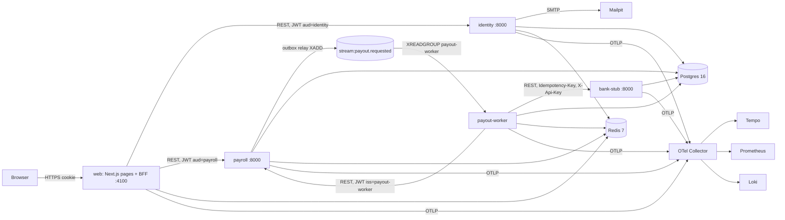
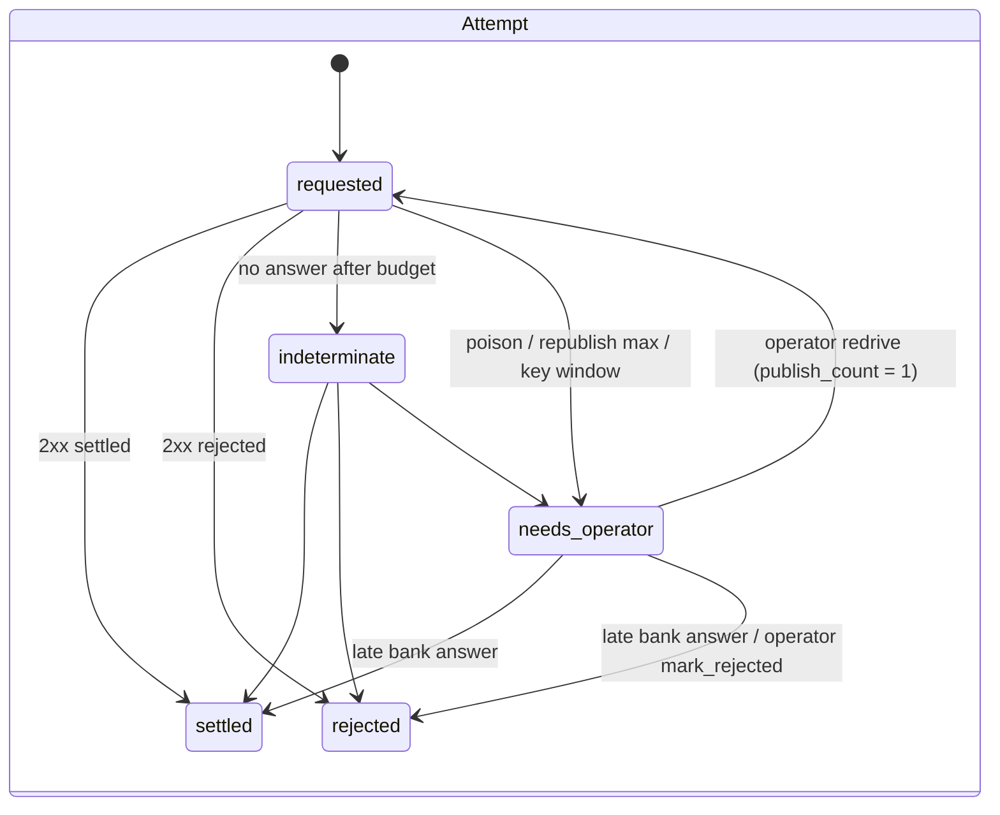
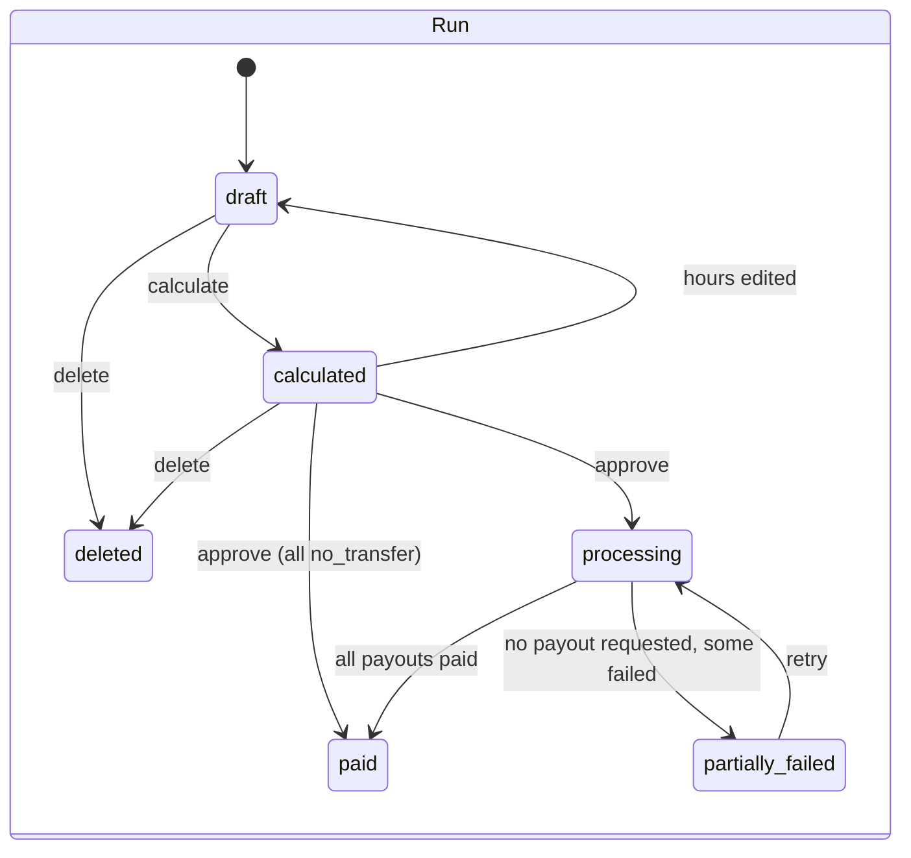

# High-level design: PayRun 0.1.0

Source: [architecture plan](../../plan/architecture-plan.md) v1.2 (accepted 2026-11-10). Requirements: [requirements.md](requirements.md).

## 1. Components

| Component | Responsibility | Owns | Package / path |
|---|---|---|---|
| web | Pages, BFF route handlers, sessions, rate limits, JWT minting, error mapping | Redis `web:*` | `apps/web` |
| identity | Users, credentials, invites, resets, roles, auth audit, email relay | schema `identity`, Redis `identity:*` | `services/identity` (`identity`) |
| payroll | Settings, employees, runs, calculation, approval, payouts and attempts, audit, outbox, re-publish, internal endpoints | schema `payroll`, Redis `payroll:*`, writes `stream:payout.requested` | `services/payroll` (`payroll`) |
| payout-worker | Consumes payouts, calls the bank, reports results | schema `payouts`, consumer group `payout-worker`, writes `.dlq` | `services/payout_worker` (`payout_worker`) |
| bank-stub | Simulated processor with a persistent idempotent ledger | schema `bank_stub` | `services/bank_stub` (`bank_stub`) |
| pycommon | Settings, logging, OTel, errors, JWT, health, DB, Redis Streams, resilient client, rate limiter, startup checks, maintenance runner | — | `libs/pycommon` |
| api-client | TS types generated from the OpenAPI specs | — | `packages/api-client` |

## 2. Flows

Sequence diagrams and failure paths for each journey are in plan §5. Requirement mapping:

| Flow | Steps (summary) | Requirements |
|---|---|---|
| F1 Bootstrap and invite | bootstrap_owner → invite → email relay → accept → session | PAY-100–103, 106, 110 |
| F2 Sign-in, sign-out, reset | login (limits, lockout) → session → requireSession re-check | PAY-104–107, 603 |
| F3 Employees and settings | CRUD with field encryption and audit | PAY-200–204 |
| F4 Prepare run | create (periods, snapshot, overlap check) → hours → calculate → review | PAY-300–304 |
| F5 Approve and pay | approve tx (dual approval, payouts, attempts, outbox) → relay → worker (instruction, bank, result) → run status | PAY-400–406, 411–413 |
| F6 Recover | edit bank details → retry (attempt n+1) → F5 from the relay; or resolve a blocked attempt | PAY-203, 500, 501, 502 |
| F7 Re-drive | maintenance re-publish → worker → result; or needs_operator | PAY-407–410 |

### 2.1 Payout state machines

- **Payout:** `requested` (current attempt requested, indeterminate or needs_operator) → `paid` (settled, or `no_transfer`) | `failed` (rejected) → retry → `requested`.
- **Run:** `draft` ⇄ `calculated` → (approve) `processing` | `paid` → `paid` | `partially_failed`. Retry: `partially_failed` → `processing`. A redrive doesn't change the run: a `needs_operator` attempt counts as payout `requested`, so its run is already `processing`, and stays so. `draft` and `calculated` can be soft-deleted (`deleted_at`, PAY-304), which frees the period. The rule is PAY-406.

## 3. Data layout

The tables are listed in plan §6 and given exactly in each low-level design.

| Store | Writer | Readers | Retention |
|---|---|---|---|
| `identity.*` | identity | identity | PAY-608 |
| `payroll.*` | payroll | payroll | PAY-608; payroll records kept |
| `payouts.*` | payout-worker | payout-worker | processed_events 30 d |
| `bank_stub.*` | bank-stub | bank-stub | dev/uat only |
| `web:sess:*`, `web:user-sess:*`, `web:rl:*` | web | web | Session TTLs (PAY-106) |
| `identity:rl:*`, `payroll:rl:*` | the owning service | the same service | The limiter window |
| `stream:payout.requested` | payroll relay | payout-worker | MAXLEN ~ 100000 |
| `stream:payout.requested.dlq` | payout-worker | operators (runbook) | `MAXLEN ~ 10000`; replay or purge per runbook |

## 4. Failure handling

This is the full fault table and the source for it (C43): plan §12.1 mirrors these rows with the same
log events, metrics and alerts, and adds test layers. Every alerted row has a runbook at
`docs/runbooks/<AlertName>.md`.

| Failure | Detection | Behaviour | Log event / metric | Alert | Requirement |
|---|---|---|---|---|---|
| Worker crash before the bank call | XAUTOCLAIM | Redelivered, paid once | `queue.message.processed` / `queue_messages_total` | — | PAY-403, NFR-02 |
| Worker crash after the bank call | XAUTOCLAIM | Same key; bank returns the original | `bank.transfer.submitted` / `payouts_bank_transfers_total` | — | PAY-403, 412, NFR-02 |
| Bank timeout after settling | Client timeout | Retry with the same key, or indeterminate → re-publish | `payout.indeterminate` / `payroll_payouts_republished_total` | `PayoutsStuck` | PAY-404, 407 |
| Bank down | Breaker | Attempts indeterminate; run processing (awaiting bank) | `external.breaker.opened` / `circuit_breaker_state` | `BankBreakerOpen`, `PayoutSettlementSlow` | PAY-404, 407, NFR-03 |
| Bank non-business 4xx | Classification | No answer → indeterminate | `bank.transfer.no_answer` / `external_requests_total` | `BankErrorRateHigh` | PAY-404 |
| bank-stub restart | — | Persistent ledger; ≤ 1 settled transfer | — | — | PAY-412, NFR-02 |
| Old attempt redelivered after a retry | Instruction 409 | ACK with no bank call | `payout.attempt_not_current` | — | PAY-403, 411 |
| Two consumers on one message | — | Unique disbursement plus bank key | — | — | PAY-403, NFR-02 |
| Re-publish racing a live consumer | — | Same key; second result 200 with the stored outcome | `payout.republished` | — | PAY-405, 407 |
| `indeterminate` after `settled` (and the reverse) | — | No change / applies | `payout.result_recorded` | — | PAY-405 |
| Late definite answer for a `needs_operator` attempt | Result endpoint | `settled`/`rejected` applies (the bank's answer wins); `indeterminate`/`poison` → 200, no change (R7, C42) | `payout.result_recorded` | — | PAY-405, 502 |
| payroll down during processing | Worker client errors | Pending → DLQ; re-publish after recovery | `queue.message.failed` / `queue_messages_total{outcome="dlq"}` | `PayoutDLQ`, `PayoutsStuck` | PAY-407, 408 |
| Poison message | Schema, amount or payout_not_found check | DLQ at once; `needs_operator`; operator resolves (PAY-502) | `payout.needs_operator` / `payroll_attempts_needs_operator` | `PayoutDLQ`, `PayoutNeedsOperator` | PAY-409 |
| Key window expired | Attempt age | GET only; 404 → needs_operator | `payout.key_window_expired` | `PayoutNeedsOperator` | PAY-410 |
| Redis down | Client errors | Session 503; limiter rules; outbox holds | `ratelimit.backend_error` / `rate_limiter_errors_total`, `outbox_unsent` | `OutboxStuck`, `RateLimiterErrors` | PAY-603, 402 |
| Redis data loss / NOGROUP | NOGROUP error | Recreate the group; re-publish | `queue.group.recreated`, `payout.republished` | `PayoutsStuck` | PAY-407, 408 |
| Outbox relay crash | Unsent age | Another replica or the restart sends | `outbox.relay.error` / `outbox_oldest_age_seconds` | `OutboxStuck` | PAY-402 |
| Slow DB (2 s) | Statement timeout | 503 `db_timeout` | `http.request` / `http_server_request_duration_seconds` | `BffAvailabilityFastBurn` | PAY-605, NFR-04 |
| Postgres down | `/readyz` | 503 `db_unavailable` fast; recovers | `db.unavailable` / `http_server_request_duration_seconds` | `BffAvailabilityFastBurn` | PAY-605 |
| identity down | BFF client | 503 `service_unavailable`; breaker | `bff.upstream_error` / `circuit_breaker_state` | `BffAvailabilityFastBurn` | PAY-602 |
| SMTP down | Relay errors | Queued; failed after 10 attempts | `email.send_failed` / `identity_emails_pending`, `identity_emails_failed_total` | `EmailOutboxStuck` | PAY-110 |
| Concurrent approve | Row lock | One wins, the other gets 409 | `payrun.approved` | — | PAY-400 |
| Demoted user | Re-check | Session ended (401) within 60 s | `auth.session.revoked` | — | PAY-107 |
| JWT skew | Verify | 5 s leeway; else 401 | `auth.token.rejected` | — | PAY-600 |

## 5. Deployment

- **Compose** (`deploy/compose/compose.yaml`; PAY-NFR-13):
  - `core`: postgres, redis, the `migrate-{identity,payroll,payouts,bank-stub}` one-shots, `bootstrap-owner` (one-shot), identity, payroll, payout-worker, bank-stub, web, mailpit.
  - `obs`: otel-collector, prometheus, alertmanager, alert-sink, tempo, loki, grafana, postgres-exporter, redis-exporter.
  - `test`: toxiproxy, plus the `compose.test.yaml` override (it publishes service and obs ports, routes the DB, Redis, payroll and bank through Toxiproxy, and raises the rate limits).
- **Ports** (host 127.0.0.1): web 4100, Grafana 4101, Mailpit 4102, identity 4110, payroll 4111, payout-worker 4112, bank-stub 4113, Tempo 4130, Loki 4131, Prometheus 4132, Alertmanager 4133, Toxiproxy 4134, alert-sink 4135.
- **Kubernetes** (`deploy/k8s`): base plus dev, uat and prod overlays.
  - Per service: Deployment, Service, ServiceAccount, ConfigMap, Secret references and a PDB.
  - Jobs: `db-bootstrap`, `migrate-<svc>-<version>`, and `bootstrap-owner`.
  - bank-stub only in dev and uat.
  - uat and prod use ExternalSecret custom resources (ADR 0008).
  - The prod overlay runs payout-worker with 0 replicas until a bank-provider ADR exists.
  - NetworkPolicies per plan §13 and ADR 0011.
- **Rollout:** migrations (expand) → services → web. **Rollback:** the previous image tags; migrations are backward compatible.

## 6. Security summary

The details are in plan §8; the requirements are PAY-600–607 and NFR-07/08.

- **Trust boundary:** the browser ↔ BFF. Services are private.
- **Tokens:** internal JWTs are issuer-bound and scoped by `cid`.
- **Data at rest:** bank fields are encrypted.
- **Redis:** ACL users per service.
- **Abuse:** rate limits, lockout, Origin checks, body limits, CSP.
- **Telemetry:** the redactor runs everywhere.

## 7. Limits

| Limit | Default | Requirement |
|---|---|---|
| Employees per company (design target) | 500 | PAY-NFR-06 |
| Page size | ≤ 100 (default 50) | PAY-202, 108 |
| Body size | 64 KB BFF / 256 KB services | PAY-604 |
| Salary / rate / hours | see PAY-201, 301 | PAY-201, 301 |
| Attempts per payout | 5 (including the first) | PAY-500 |
| Re-publishes per attempt | 10 | PAY-407 |
| Worker concurrency | 16 per replica | PAY-403 |

## 8. Observability

| Item | Details | Requirement |
|---|---|---|
| SLO: availability | 99.5% non-5xx at the BFF; recording rules `sli:bff_errors:ratio_rate{5m,30m,1h,6h}` | PAY-NFR-04 |
| SLO: latency | p95 < 300 ms (`bff_request_duration_seconds`) | PAY-NFR-05 |
| SLO: settlement | p95 ≤ 60 s (`payroll_payout_settlement_seconds`) | PAY-NFR-06 |
| Alerts (page) | `BffAvailabilityFastBurn`, `PayoutSettlementSlow`, `PayoutDLQ`, `PayoutsStuck`, `PayoutNeedsOperator` → `alert-sink` `/page` | PAY-NFR-10, 11 |
| Alerts (ticket/warning) | `BffAvailabilitySlowBurn`, `OutboxStuck`, `ConsumerLagGrowing`, `BankBreakerOpen`, `BankErrorRateHigh`, `SigninFailuresSpike`, `RedisMemoryHigh`, `PayoutStreamNearMaxlen`, `EmailOutboxStuck`, `RateLimiterErrors`, `PodRestarts`, `CollectorDropping` → `alert-sink` `/ticket` | PAY-NFR-10 |
| Dashboards | `service-overview.json`, `journeys.json`, `queues.json`, `bank.json`, `platform.json` in `deploy/observability/grafana/dashboards/` | PAY-NFR-10 |
| Trace | One trace per J4 journey across all hops | PAY-NFR-09 |

Each low-level design lists its exact log events, metrics and spans.
