# Tasks: PayRun 0.1.0

Status (2026-11-10): not started. Release 0.1.0. Skeleton tasks (S*) run on `main`; feature,
hardening and release tasks (F*, H*, R1) run on `release/0.1.0`.

**Rules for every task:**
- **Tests in the same change.**
  - Each test cites the requirement ID it proves in its docstring or a comment.
  - Before marking a task done, run the gates the task touches:
    - Python: `uv run ruff check`, `uv run ruff format --check`, `uv run mypy --strict`, `uv run pytest` with coverage;
    - web: `pnpm -r lint`, `pnpm -r typecheck`, `pnpm -r test`;
    - stack-level tests: `scripts/stack.sh up` first.
- **Contracts first.**
  - The OpenAPI specs (`services/*/openapi.json`) and `contracts/events/*.json` are owned by the lead.
  - A subagent that needs a contract change stops and reports it.
  - Shared files belong to the lead: `libs/pycommon`, `contracts/`, `scripts/`, `deploy/`, `.github/`, root workspace files and lock files.
- **Data hygiene.**
  - No secrets, tokens, bank numbers or salaries in logs (PAY-NFR-07).
  - Unit tests run with no network; integration tests reach only Testcontainers.
- **Commits.** Local checkpoint commits (secret-scanned) after each task group passes its check. Push only at S10 and R1.

```mermaid
flowchart LR
  S1[S1 scaffold] --> S2[S2 pycommon] --> S3[S3 bootstrap SQL + Redis ACL]
  S3 --> S4[S4 identity: login] & S5[S5 payroll: skeleton run] & S6[S6 worker + bank-stub]
  S4 & S5 & S6 --> S7[S7 web: login + run page]
  S7 --> S8[S8 compose + obs + tests every layer] --> S9[S9 k8s + CI] --> S10[S10 first push, green CI]
  S10 --> F1[F1 identity features] & F2[F2 payroll employees/settings] & F3[F3 payroll runs] & F4[F4 payouts hardening] & F5[F5 web pages]
  F2 --> F3 --> F4
  F1 & F3 & F4 --> F5
  F5 --> F6[F6 e2e J1–J5 + load scenarios]
  F6 --> H1[H1 gates + failure table] --> H2[H2 load, alerts, drills] --> H3[H3 security review + nightly]
  H3 --> R1[R1 docs, version, changelog, PR]
```

## Walking skeleton (Step 3, `main`)

The skeleton journey: sign in as the seeded owner → create a monthly run for seeded salaried employees → calculate → approve as the second seeded approver → the worker pays through bank-stub → the run shows `paid`, all in one trace.

| ID | Task | Covers | Depends | Done when | Est. | Status |
|---|---|---|---|---|---|---|
| S1 | Repo scaffold: uv and pnpm workspaces, `.gitignore`, `.editorconfig`, pre-commit (ruff, Prettier, ESLint, gitleaks), pinned versions, `scripts/dev-env.sh` (all secrets and keys from plan §8) | PAY-NFR-12 | — | `uv sync --locked`, `pnpm install --frozen-lockfile` pass; `dev-env.sh` makes a complete `.env` idempotently | 2 h | |
| S2 | `libs/pycommon`: settings, JSON logging with redaction, OTel, errors, issuer-bound JWT verify and sign, health, DB, Redis Streams (producer, consumer base, outbox relay), resilient client, rate limiter, startup checks, maintenance runner, `create_app` | PAY-600, PAY-602, PAY-603, PAY-605, PAY-NFR-07 | S1 | Unit tests pass at ≥ 90% coverage | 6 h | |
| S3 | DB bootstrap SQL (4 schemas, migrator and runtime roles, exporter role) and the Redis ACL file generation | PAY-606, PAY-607 | S2 | Integration: grants test passes; web ACL user can't XADD | 2 h | |
| S4 | identity skeleton: users and credentials tables, `bootstrap_owner` CLI, `POST /v1/auth/login`, `GET /v1/users/me`, invite and accept (for the seed), email relay to Mailpit | PAY-100, PAY-101, PAY-103, PAY-104, PAY-110 | S3 | Unit and integration tests pass; `openapi.json` exported | 5 h | |
| S5 | payroll skeleton: settings seed, employees (create, list), runs (create monthly, calculate, approve), payouts and attempts, outbox relay, internal instruction and result endpoints, run status rule | PAY-200, PAY-201, PAY-202, PAY-204, PAY-300, PAY-302, PAY-303, PAY-400, PAY-402, PAY-405, PAY-406, PAY-411 | S3 | Unit (calc properties) and integration (outbox, approve) tests pass; `openapi.json` and event schema committed | 8 h | |
| S6 | payout-worker (consume, instruction, bank, result, idempotency) and bank-stub (persistent ledger) | PAY-403, PAY-404, PAY-412 | S3 | Integration: outbox → stream → worker → bank → result path passes; duplicate delivery is a no-op | 6 h | |
| S7 | web: Next.js app, session and requireSession, internal JWT, generated api-client, login page, a minimal run page (create, calculate, approve, status), proxy.ts with CSP, OTel and pino | PAY-104, PAY-106, PAY-600, PAY-601, PAY-604, PAY-413 | S4, S5 | Vitest passes; `next build` passes with no secrets; contract drift check passes | 6 h | |
| S8 | Compose (core, obs, test), `stack.sh`, Collector, Prometheus, Alertmanager and alert-sink, Tempo, Loki, Grafana (Service overview dashboard), `seed.py`; tests at every layer: Schemathesis per service, one Playwright journey with the trace assertion, k6 smoke, one Toxiproxy fault (slow DB) | PAY-609, PAY-NFR-09, PAY-NFR-13 | S6, S7 | `stack.sh up` is healthy; e2e trace spans web → payroll → worker → bank-stub; Loki logs link; k6 smoke meets thresholds | 8 h | |
| S9 | Kubernetes base and overlays (dev, uat, prod), Jobs, NetworkPolicies; CI `ci.yml` and `nightly.yml` calling `scripts/ci/*.sh`, with every gate at its final threshold | PAY-NFR-12, PAY-NFR-13 | S8 | kubeconform passes on every overlay; every `scripts/ci/*.sh` passes locally | 5 h | |
| S10 | First push: secret scan; fold the checkpoints into one commit; push `main`; fix CI until green | PAY-NFR-12 | S9 | First CI run on `main` is green | 2 h | |

## Features (Step 4, `release/0.1.0`)

| ID | Task | Covers | Depends | Done when | Est. | Status |
|---|---|---|---|---|---|---|
| F1 | identity complete: resend invite, password reset, user admin (roles, deactivate, last-admin and self rules), `roles_version`, auth audit, lockout with production values, email retry limits, maintenance purges | PAY-102, PAY-105, PAY-107, PAY-108, PAY-109, PAY-110, PAY-608 | S10 | identity unit and integration tests pass at ≥ 85% coverage | 6 h | |
| F2 | payroll setup: settings PUT with audit, employees read, update and deactivate, bank-edit tracking, field-key rotation, audit events endpoint | PAY-200, PAY-202, PAY-203, PAY-204 | S10 | payroll unit and integration tests pass | 4 h | |
| F3 | payroll runs complete: biweekly periods, overlap check, hours, hourly calculation, delete, list endpoints, payslips, dual approval with snapshot | PAY-300, PAY-301, PAY-302, PAY-303, PAY-304, PAY-401, PAY-NFR-01 | F2 | Property tests (PAY-NFR-01) and dual-approval tests pass | 6 h | |
| F4 | Payout robustness: retry, payout list with history, operator resolution (redrive or mark_rejected), re-publish with backoff, needs_operator, poison and DLQ, key window, NOGROUP recovery, graceful shutdown, scrape-time gauges, maintenance purges (bank details, snapshots) | PAY-407, PAY-408, PAY-409, PAY-410, PAY-500, PAY-501, PAY-502, PAY-608, PAY-NFR-02, PAY-NFR-03 | F3 | The stateful payout model and every §12.1 integration row pass | 8 h | |
| F5 | web complete: accept, reset, users, settings, employees, run list and detail (payslips and payouts tabs, polling, badges), retry, operator resolve dialog, audit pages; role re-check; rate limits; telemetry endpoint; error mapping | PAY-102, PAY-103, PAY-105, PAY-107, PAY-108, PAY-109, PAY-413, PAY-501, PAY-502, PAY-602, PAY-603, PAY-604, PAY-NFR-14 | F1, F3, F4 | Vitest ≥ 80% coverage; `next build` passes | 8 h | |
| F6 | e2e for J1–J5 (access, employees, pay run, approve-pay, recover, role change, errors, trace, a11y); k6 `full.js` and `settlement.js`; `seed.py --employees 500` | PAY-NFR-05, PAY-NFR-06, PAY-NFR-09, PAY-NFR-14, PAY-609 | F5 | All Playwright specs pass on the stack | 6 h | |

## Hardening (Step 6)

| ID | Task | Covers | Depends | Done when | Est. | Status |
|---|---|---|---|---|---|---|
| H1 | Gates at thresholds; every failure-table row (HLD §4) implemented with its test, log event and metric; resilience suite (worker kill, bank down and timeout, bank-stub restart, payroll down, Redis down and FLUSHALL, Postgres down, identity down, SMTP down) | PAY-NFR-02, PAY-NFR-03, PAY-NFR-12 | F6 | `tests/resilience` passes; all PR gates green locally | 8 h | |
| H2 | Full and soak load against the SLOs, with the capacity recorded in the plan; all five dashboards; every alert rule with a promtool test and a runbook; alert drills through Alertmanager to the sink | PAY-NFR-04, PAY-NFR-05, PAY-NFR-06, PAY-NFR-10, PAY-NFR-11 | H1 | SLOs met; each paging alert drilled; runbooks exist | 6 h | |
| H3 | Security review (authz in every handler, JWT audiences and issuers, CSRF and Origin, rate limits, headers and CSP, no secrets in logs, non-root images, NetworkPolicies, audits); privacy checks; nightly workflow run on the release branch | PAY-601, PAY-604, PAY-NFR-07, PAY-NFR-08, PAY-NFR-12 | H2 | Review findings fixed; nightly passes once | 4 h | |

## Release (Step 7)

| ID | Task | Covers | Depends | Done when | Est. | Status |
|---|---|---|---|---|---|---|
| R1 | Docs (README, ARCHITECTURE, RUNBOOK, TESTING, API reference, `.env.example`), `CLAUDE.md`, checkpoint and memory, version 0.1.0, CHANGELOG, one PR, green CI | PAY-NFR-12 | H3 | PR open against `main` with green checks | 4 h | |

## Coverage

| Requirement | Tasks |
|---|---|
| PAY-100 | S4 |
| PAY-101 | S4 |
| PAY-102 | F1, F5 |
| PAY-103 | S4, F5 |
| PAY-104 | S4, S7 |
| PAY-105 | F1, F5 |
| PAY-106 | S7 |
| PAY-107 | F1, F5 |
| PAY-108 | F1, F5 |
| PAY-109 | F1, F5 |
| PAY-110 | S4, F1 |
| PAY-200 | S5, F2 |
| PAY-201 | S5 |
| PAY-202 | S5, F2 |
| PAY-203 | F2 |
| PAY-204 | S5, F2 |
| PAY-300 | S5, F3 |
| PAY-301 | F3 |
| PAY-302 | S5, F3 |
| PAY-303 | S5, F3 |
| PAY-304 | F3 |
| PAY-400 | S5 |
| PAY-401 | F3 |
| PAY-402 | S5 |
| PAY-403 | S6 |
| PAY-404 | S6 |
| PAY-405 | S5 |
| PAY-406 | S5 |
| PAY-407 | F4 |
| PAY-408 | F4 |
| PAY-409 | F4 |
| PAY-410 | F4 |
| PAY-411 | S5 |
| PAY-412 | S6 |
| PAY-413 | S7, F5 |
| PAY-500 | F4 |
| PAY-501 | F4, F5 |
| PAY-502 | F4, F5 |
| PAY-600 | S2, S7 |
| PAY-601 | S7, H3 |
| PAY-602 | S2, F5 |
| PAY-603 | S2, F5 |
| PAY-604 | S7, F5, H3 |
| PAY-605 | S2 |
| PAY-606 | S3 |
| PAY-607 | S3 |
| PAY-608 | F1, F4 |
| PAY-609 | S8, F6 |
| PAY-NFR-01 | F3 |
| PAY-NFR-02 | F4, H1 |
| PAY-NFR-03 | F4, H1 |
| PAY-NFR-04 | H2 |
| PAY-NFR-05 | F6, H2 |
| PAY-NFR-06 | F6, H2 |
| PAY-NFR-07 | S2, H3 |
| PAY-NFR-08 | H3 |
| PAY-NFR-09 | S8, F6 |
| PAY-NFR-10 | H2 |
| PAY-NFR-11 | H2 |
| PAY-NFR-12 | S1, S9, S10, H1, H3, R1 |
| PAY-NFR-13 | S8, S9 |
| PAY-NFR-14 | F5, F6 |
